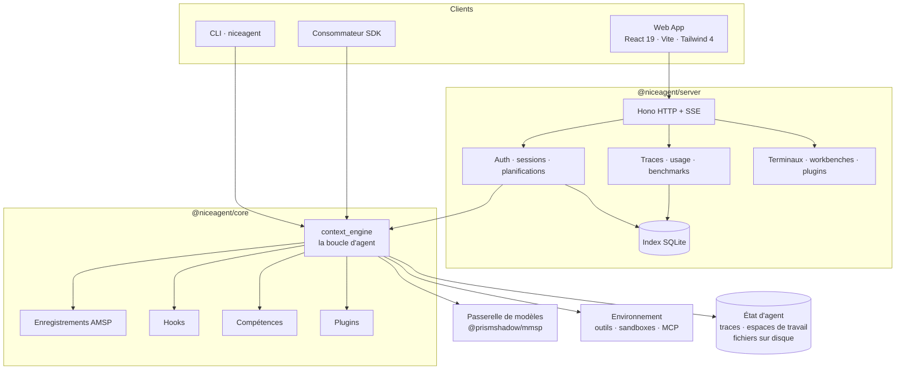
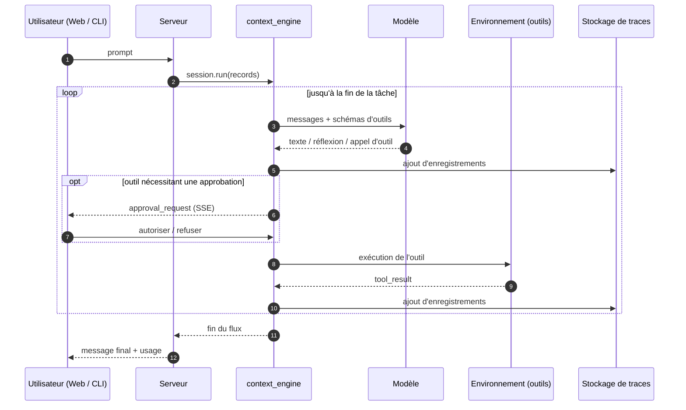

<p align="center">
  
</p>

<h1 align="center">NiceAgent</h1>

<p align="center"><strong>Un framework d'agents généraliste et auto-hébergeable que vous façonnez : un cœur de raisonnement indépendant du fournisseur, une bibliothèque de plugins et de compétences, une Web App, une CLI et un harnais d'évaluation — dans un seul dépôt.</strong></p>

<p align="center">
  <a href="LICENSE"></a>
  = 24" />
  
  
  <a href="https://github.com/gqallen931/niceagent/discussions"></a>
</p>

<p align="center">
  <a href="README.md">简体中文</a> |
  <a href="README.en.md">English</a> |
  <a href="README.ja.md">日本語</a> |
  <a href="README.ko.md">한국어</a> |
  Français |
  <a href="README.ru.md">Русский</a>
</p>

---

## Qu'est-ce que NiceAgent

NiceAgent est un **framework d'agents généraliste**. Il fournit toute la mécanique autour d'un appel
de modèle — boucle d'exécution, sessions durables, approbations d'outils, un hôte qui sert plusieurs
utilisateurs et projets, une Web App, une CLI, un format de plugin, des traces et de l'évaluation —
puis s'efface pour que vous remplaciez uniquement ce qui rend votre produit différent.

Ce n'est délibérément pas un produit vertical : aucun domaine imposé, aucun workflow à adopter,
aucun service hébergé à contacter. Le framework tourne sur vos machines, stocke tout sur votre
disque et s'étend par des interfaces documentées plutôt que par un patch du cœur.

Trois couches, chacune utilisable seule :

| Couche | Paquet | Quand l'utiliser | Ce que vous pouvez changer |
| --- | --- | --- | --- |
| **Moteur** | `@niceagent/core` + `@niceagent/amsp` | Vous construisez votre produit et voulez la boucle, les outils, les approbations, les traces | Modèles, outils, environnement, prompts, hooks, disposition du stockage |
| **Hôte** | `@niceagent/server` | Vous voulez servir des agents à une équipe, avec comptes, projets, persistance | Auth, routes, planifications, sandboxes, runtime de sessions |
| **Surface produit** | `@niceagent/web` + `@niceagent/cli` | Vous voulez quelque chose d'utilisable dès le premier jour | Pages, navigation, textes, thème, marque, commandes CLI |

## Pour qui

- **Équipes produit** qui veulent des agents dans un produit existant sans réécrire sessions,
  approbations, streaming et historique.
- **Équipes plateforme** qui doivent héberger des agents pour plusieurs équipes, avec comptes,
  quotas, audit et isolation.
- **Développeurs et chercheurs en agents** qui veulent un runtime complet pour mesurer chaque
  changement : cas de benchmark, rubriques et traces par cas sont inclus.

## En action

<p align="center">
  
</p>

<p align="center"><sub>La Web App : réponses en streaming, étapes d'outils, coût et tokens par exécution, navigation projets/sessions.</sub></p>

<p align="center">
  
</p>

<p align="center"><sub>La CLI, sur la même racine de données : <code>niceagent --help</code> et <code>niceagent session ls</code>.</sub></p>

| Agents | Plugins |
| --- | --- |
|  |  |

| Modèles | Évaluation |
| --- | --- |
|  |  |

## Ce que contient le dépôt

| Surface | Rôle |
| --- | --- |
| **SDK cœur** (`@niceagent/core`) | Boucle ReAct en streaming sur des enregistrements AMSP, interfaces `LLMInterface` / `EnvironmentInterface` remplaçables, outils concurrents, approbations, interruptions, reconnexion automatique et compaction du contexte. |
| **Serveur** (`@niceagent/server`) | Hono HTTP + SSE, authentification multi-utilisateurs, autorisation par projet, runtime de sessions, planifications, terminaux pty côté serveur, comptabilité d'usage, traces, installation de plugins, exécution de benchmarks. |
| **Web App** (`@niceagent/web`) | SPA React 19 + Vite + Tailwind 4 : chat, agents, plugins, modèles, machines, centre de coûts, centre d'évaluation, mode organisation, workbenches, terminal. |
| **CLI** (`@niceagent/cli`) | `niceagent` : REPL, exécution unique, configuration, gestion sessions/agents/projets, coûts, planifications, navigateur d'agent, et `niceagent web` pour tout lancer. |
| **Bibliothèque de plugins** | 29 paquets de plugins intégrés : compétences, hooks, serveurs MCP et pages de workbench, versionnés et installables par agent. |
| **Centre d'évaluation** | Cas de benchmark, notation par rubrique, traces par cas et tableaux de scores — depuis l'UI, la CLI ou un agent. |

## Architecture

NiceAgent sépare **la boucle** de **l'hôte**. Le cœur sait penser et agir ; le serveur héberge de
nombreux agents, utilisateurs et projets ; la Web App et la CLI sont deux rendus du même flux
d'enregistrements.



Deux règles tiennent les frontières :

1. **Le moteur parle en enregistrements, pas en transport.** Tout ce que produisent le modèle et les
   outils est un enregistrement [AMSP](packages/amsp) ; le serveur HTTP/SSE, la CLI et la Web App
   n'en sont que des lecteurs.
2. **Les fichiers sont la vérité, SQLite est un index.** L'état des agents, les traces et les espaces
   de travail vivent sous la racine de données, partagés par le SDK, la CLI et le serveur.

Une exécution de bout en bout :



Frontières de modules, contrats d'extension et compromis : [docs/ARCHITECTURE.md](docs/ARCHITECTURE.md).

## Personnaliser NiceAgent

Tout ce qui suit est une interface utilisable sans patcher le moteur. Choisissez la plus petite qui
résout votre problème.

| Ce que vous voulez | Point d'extension | Emplacement |
| --- | --- | --- |
| Changer le raisonnement | Prompt système, `AGENTS.md`, configuration du modèle | Réglages de l'agent / du projet |
| Ajouter une capacité | Un outil, ou un serveur MCP | Couche environnement / manifeste de plugin |
| Enseigner un domaine | Une compétence (`SKILL.md`) | `plugins/*/skills/` |
| Réagir au cycle de vie | Un paquet de hooks (`prompt` / `tool` / `stop`) | `plugins/*/hooks/` |
| Ajouter une page produit | Une page de workbench, ou une page fournie par le serveur | `plugins/*/workbenches/`, `packages/web/src/module.json` |
| Isoler l'exécution | Un backend de sandbox | `plugins/sandbox-*` |
| Mesurer les changements | Un cas de benchmark avec rubrique | `benchmarks/` |
| Changer l'apparence, les textes, la marque | Jetons de thème, dictionnaires, logo, nom de l'app | `packages/ui`, `packages/web/src/lib/` |
| Construire votre propre produit | Le SDK seul | `@niceagent/core` |

### Embarquer le moteur comme SDK

Ni serveur, ni UI, ni CLI ne sont nécessaires :

```ts
import { createAgent, isCompleteModelMessage, userText } from "@niceagent/core";

const agent = await createAgent({ agentId: "default_agent" });
const session = await agent.createSession({ workspaceDir: process.cwd() });

for await (const record of session.run([userText("Crée hello.txt contenant hi")], {
  approve: async () => "allow", // La frontière Human : une fois par appel d'outil
})) {
  if (isCompleteModelMessage(record) && record.payload.type === "text") {
    process.stdout.write(record.payload.text);
  }
}
```

### Ajouter un outil

Un outil est un objet avec un nom, une définition donnée au modèle et un générateur asynchrone qui
streame sa sortie. `Environment` n'a pas besoin d'être modifié :

```ts
import type { BuiltinTool } from "@niceagent/core";
import { partialToolCallOutput } from "@niceagent/amsp/records";

export function createJiraLookup(definition): BuiltinTool {
  return {
    name: "jira_lookup",
    definition, // { name, description, parameters, permission?, timeoutMs? }
    async *execute(args, ctx) {
      const issue = await jira.issue(String(args.key ?? ""));
      yield partialToolCallOutput({
        eventType: "delta",
        toolCallId: ctx.toolCallId,
        output: `# ${issue.key}: ${issue.title}`,
      });
      return { status: "completed" };
    },
  };
}
```

Enregistrez la fabrique dans la table des outils intégrés
([registry.ts](packages/core/src/environment/tools/registry.ts)) et activez-la dans `tools.builtin`.

### Distribuer un plugin

Un plugin est un paquet npm ordinaire ; seul le bloc `niceagent` est spécial. Les fichiers sont lus à
l'exécution, donc modifier une compétence prend effet immédiatement.

```json
{
  "name": "@acme/warehouse-tools",
  "version": "0.1.0",
  "niceagent": {
    "title": "Outils d'entrepôt",
    "category": "office-productivity",
    "skills": ["stock-check"],
    "mcp_servers": [{ "name": "wms", "command": "npx", "args": ["-y", "@acme/wms-mcp"] }]
  }
}
```

```
warehouse-tools/
  package.json
  icon.svg
  skills/stock-check/SKILL.md   # frontmatter : name, description, version (YYYY.MM.DD.N)
  hooks/stop.mjs                # JSON sur stdin, JSON sur stdout
```

Un hook reçoit un objet JSON sur stdin et répond sur stdout ; le hook `stop` est consulté après
chaque tâche :

```js
// stdin:  { "hook": "stop", "session_id": "...", "trace_path": "..." }
// stdout: { "decision": "continue", "input": "<tour suivant>" } ou { "decision": "stop", "reason": "..." }
```

Chaque plugin de `plugins/` est un exemple complet et exécutable.

### Ajouter une page de workbench

Un workbench donne à un agent sa propre petite UI, encadrée dans le chat : un module iframe, sans
étape de build.

```json
{
  "name": "my-workbench",
  "type": "module",
  "niceagent": {
    "version": "2026.11.02.1",
    "modules": [{
      "name": "Workbench",
      "contributes": {
        "WebModule.sessionTabs": [{
          "id": "my.main",
          "key": "my-workbench",
          "title": "Mon workbench",
          "renderer": { "iframe": { "src": "ui/index.html" } }
        }]
      }
    }]
  }
}
```

### Remplacer le sandbox d'exécution

L'exécution d'outils est une interface. Quatre backends sont fournis — `bwrap`, `seatbelt`, `WSL` et
`DSH` — et un nouveau (conteneur, exécution distante, simple politique) se branche de la même façon :

```ts
export interface SandboxBackend {
  readonly id: string;
  available(): Promise<boolean>;
  wrap(command: string): Promise<{ command: string; args: string[] }>;
}
```

### Ajouter un cas d'évaluation

Les benchmarks sont des données : un répertoire par cas, avec énoncé, rubrique et configuration.

```
benchmarks/my-benchmark/
  benchmark_config.toml
  CASE-001-refund-policy/
    statement/README.md
    rubric/README.md
```

### Marque, textes, thème

- Les textes sont dans `packages/web/src/lib/strings.ts` (chinois) et `strings-en.ts` (anglais), avec
  `appName` ; le logo est `packages/web/public/niceagent-logo.svg`.
- Les jetons de design sont dans `packages/ui/src/theme.css` ; les trois thèmes sont des variables
  CSS, un quatrième est un bloc de plus.
- Les pages sont déclarées dans `packages/web/src/module.json` et rendues par
  `packages/web/src/router.tsx`.

### Garder votre fork maintenable

- Les paquets partagent **une seule version** ; dépendez des paquets, pas des chemins internes.
- **Les enregistrements AMSP sont additifs** : vos lecteurs continuent de fonctionner.
- **Les plugins sont versionnés indépendamment** via leur bloc `niceagent`.
- Préférez un plugin ou un workbench à un patch de `packages/core` : les deux premiers survivent aux
  mises à jour.

## Comparaison

NiceAgent est un harnais, pas une bibliothèque d'orchestration : il concurrence « le reste de la
pile ». Version longue : [docs/COMPARISON.md](docs/COMPARISON.md).

| | NiceAgent | LangGraph | CrewAI | OpenAI Agents SDK | Claude Agent SDK | OpenHands / SWE-agent |
| --- | --- | --- | --- | --- | --- | --- |
| Forme | Framework auto-hébergeable | Bibliothèque de graphes | Bibliothèque multi-agents | Primitives d'agents | SDK de boucle | Produit d'agent de code |
| UI Web + auth + multi-projets inclus | **Oui** | Non | Non | Non | Non | Partiel (mono-utilisateur) |
| CLI sur le même état | **Oui** (`niceagent`) | Non | Partiel | Non | Partiel | Oui |
| Couche de modèles indépendante | **Oui** (passerelle + catalogue + OAuth) | Oui | Oui | Orienté OpenAI | Orienté Anthropic | Oui |
| Traces durables, rejeu, reprise | **Oui** (enregistrements append-only) | Checkpoints (stockage à fournir) | Partiel | Pas de stockage | Fichiers de session | Oui |
| Format de plugin/compétence versionné | **Oui** (paquets npm, 29 inclus) | Non | Outils seulement | Outils seulement | Compétences/MCP | Outils seulement |
| Backends d'exécution sandboxés | **Oui** (bwrap · seatbelt · WSL · DSH) | Non | Non | Non | Non | Conteneurs |
| Harnais d'évaluation intégré | **Oui** (rubriques, cas, scores) | Non | Non | Non | Non | Style SWE-bench |
| Langage de toute la pile | TypeScript (Node ≥ 24) | Python/JS | Python | Python/JS | Python/TS | Python |

Si vous avez déjà un produit et ne cherchez qu'une primitive de graphe, LangGraph ou le SDK OpenAI
sont des dépendances plus petites. Choisissez NiceAgent quand vous voulez que le framework —
persistance, approbations, UI, CLI, plugins, évaluation — existe déjà et soit à vous.

## Démarrage rapide

**Prérequis :** Node.js ≥ 24, pnpm ≥ 11.

```bash
git clone https://github.com/gqallen931/niceagent.git
cd niceagent
pnpm install
pnpm build
pnpm dev            # API sur :7368, Web App sur :7365
```

Ouvrez <http://localhost:7365/>. Sur une racine de données neuve, le serveur affiche un lien de
première connexion à usage unique (`/api/auth/claim?token=…`). En environnement automatisé, fixez
plutôt le mot de passe :

```bash
NICEAGENT_SEED_ADMIN_PASSWORD='choose-something-long' pnpm dev
```

Configurez un modèle dans **Modèles** (tout point d'accès compatible OpenAI convient), créez un
agent, puis discutez.

### CLI

```bash
pnpm niceagent --help                  # exécuter la CLI depuis les sources
pnpm niceagent run -m "Résume ce dépôt"   # une tâche puis sortie
pnpm niceagent chat                    # REPL (/compact, /clear, /exit)
pnpm niceagent session ls              # sessions de la racine de données
pnpm niceagent cost --by model         # tokens et coût
pnpm niceagent server --port 7364      # serveur sans interface
```

Une fois publié, la même commande s'installe globalement : `npm install -g @niceagent/cli`.

### Docker

```bash
docker build -t niceagent/niceagent:dev .
docker run -d -p 127.0.0.1:7364:7364 -v niceagent-data:/data niceagent/niceagent:dev
docker compose -f docker/compose.yaml up -d
docker compose logs niceagent          # lien de première connexion
```

## Structure du dépôt

```
packages/
  core/        boucle d'agent, interfaces, hooks, compétences, chargeur de plugins, écriture de traces
  amsp/        protocole d'enregistrements partagé par toutes les surfaces
  server/      serveur HTTP + SSE, auth, stockage, runtime, terminaux, benchmarks
  web/         Web App React (chat, agents, plugins, modèles, coûts, évaluation, organisation)
  cli/         la commande `niceagent`
  skills/      analyse des SKILL.md et helpers de frontmatter
  hmr/         primitives de mise à jour à chaud de la plateforme en cours
  ui/          primitives UI partagées et jetons de design
plugins/       bibliothèque de plugins (compétences, hooks, MCP, workbenches, sandboxes)
benchmarks/    cas de benchmark et rubriques
scripts/       build, génération de code, outillage du dépôt
docs/          architecture, comparaison, captures d'écran
```

## Configuration

| Variable | Rôle | Défaut |
| --- | --- | --- |
| `NICEAGENT_HOME` | Racine de données partagée (SDK, CLI, serveur) | `~/.niceagent/data` |
| `PORT` / `HOST` | Port / adresse d'écoute | `7364` / `127.0.0.1` |
| `NICEAGENT_WEB_DIST` | Build Web à servir (fallback SPA) | `../web/dist` |
| `NICEAGENT_WEB_DB` | Fichier SQLite | `<root>/web.db` |
| `NICEAGENT_SEED_ADMIN_PASSWORD` | Fixe le mot de passe admin initial au lieu d'afficher un lien | non défini |
| `NICEAGENT_TRUST_PROXY` | Faire confiance à `x-forwarded-proto` derrière un proxy TLS (`1`) | non défini |
| `NICEAGENT_UPDATE_CHECK` | Désactiver la vérification de version sortante (`off`) | activé |

Les identifiants des modèles restent dans le fichier de configuration privé du projet (mode `0600`)
et sont toujours masqués par l'API. Les clés des fournisseurs peuvent aussi venir de variables
d'environnement.

## Sécurité

- Mots de passe en `scrypt` ; une session est une ligne `auth_sessions` qui ne stocke que le SHA-256
  du jeton du cookie, valable 30 jours avec renouvellement glissant.
- Toute écriture exige un Content-Type JSON et une requête de même origine ; les flux WebSocket
  vérifient `Origin` en plus du cookie.
- Les terminaux sont un shell avec le compte OS du serveur : n'exposez pas un déploiement avec
  terminaux à des comptes auxquels vous ne donneriez pas SSH.
- Les backends de sandbox confinent l'exécution des outils ; les niveaux les plus stricts sont
  activés par agent.
- Limites connues : [.github/SECURITY.md](.github/SECURITY.md).

## Contribuer

Issues et pull requests bienvenues. Commencez par [.github/CONTRIBUTING.md](.github/CONTRIBUTING.md),
respectez le [Code de conduite](.github/CODE_OF_CONDUCT.md), et lancez `pnpm lint`,
`pnpm typecheck` et `pnpm test` avant d'ouvrir une PR.

## Licence

Apache-2.0 — voir [LICENSE](LICENSE). Les composants tiers et leurs licences sont listés dans
[THIRD-PARTY-NOTICES.md](THIRD-PARTY-NOTICES.md).
