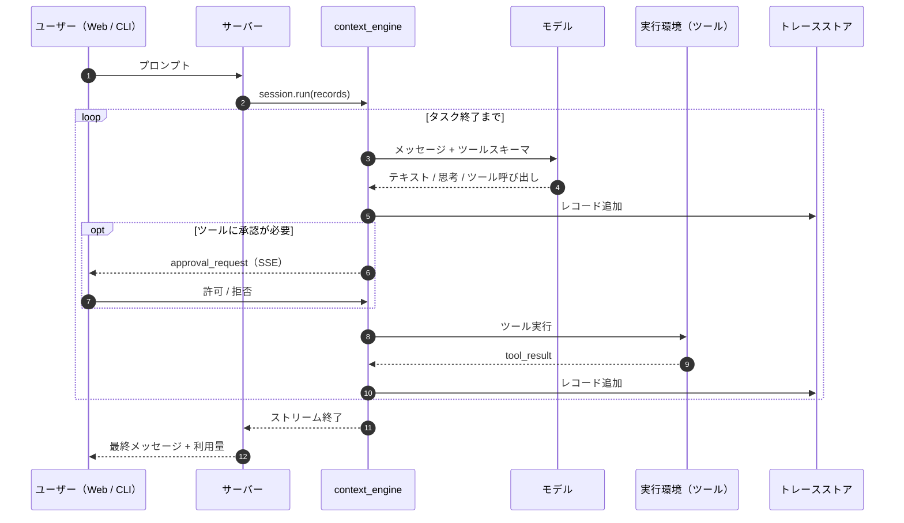

<p align="center">
  
</p>

<h1 align="center">NiceAgent</h1>

<p align="center"><strong>自由に形を変えられる、汎用かつセルフホスト可能なエージェントフレームワーク — モデル非依存の推論コア、プラグイン／スキルライブラリ、Web App、CLI、評価基盤をひとつのリポジトリに。</strong></p>

<p align="center">
  <a href="LICENSE"></a>
  = 24" />
  
  
  <a href="https://github.com/gqallen931/niceagent/discussions"></a>
</p>

<p align="center">
  <a href="README.md">English</a> |
  <a href="README.zh.md">简体中文</a> |
  日本語 |
  <a href="README.ko.md">한국어</a> |
  <a href="README.fr.md">Français</a> |
  <a href="README.ru.md">Русский</a>
</p>

---

## NiceAgent とは

NiceAgent は**汎用のエージェントフレームワーク**です。モデル呼び出しの周囲にある機械一式——実行ループ、永続セッション、ツール承認、多数のユーザーとプロジェクトを扱うホスト、Web App、CLI、プラグイン形式、トレース、評価——を提供し、製品を差別化する部分だけをあなたが置き換えられるように設計されています。

特定業種向けの完成品ではありません。固定のドメインも、採用必須のワークフローも、接続必須のホスト型サービスもありません。フレームワークはあなたのマシンで動き、データはすべてあなたのディスクに残り、拡張は文書化されたインターフェースで行います。

三つの層があり、どれか一つだけを使うこともできます。

| 層 | パッケージ | こんなときに | 変更できるもの |
| --- | --- | --- | --- |
| **エンジン** | `@niceagent/core` + `@niceagent/amsp` | 自社製品にループ・ツール・承認・トレースだけが欲しい | モデル、ツール、実行環境、プロンプト、フック、保存レイアウト |
| **ホスト** | `@niceagent/server` | チーム向けに、アカウント・プロジェクト・永続化ごと運用したい | 認証、ルート、スケジュール、サンドボックス、セッション実行 |
| **製品面** | `@niceagent/web` + `@niceagent/cli` | 初日から人が使える形が欲しい | ページ、ナビゲーション、文言、テーマ、ブランド、CLI コマンド |

## 対象

- **製品チーム**：既存製品にエージェント機能を組み込みたいが、セッション・承認・ストリーミング・トレースを一から作りたくない。
- **プラットフォームチーム**：複数チームにエージェントを提供し、アカウント・配分・監査・分離が必要。
- **エージェント開発者・研究者**：変更を測定できる完全なランタイムが欲しい。ベンチマーク、ルーブリック、ケース単位のトレースが同梱されます。

## 実行の様子

<p align="center">
  
</p>

<p align="center"><sub>Web App：ストリーミング応答、ツールステップ、実行ごとのトークンとコスト、プロジェクト／セッションのナビゲーション。</sub></p>

<p align="center">
  
</p>

<p align="center"><sub>同じデータルートに対する CLI：<code>niceagent --help</code> と <code>niceagent session ls</code>。</sub></p>

| エージェント | プラグイン |
| --- | --- |
|  |  |

| モデル | 評価 |
| --- | --- |
|  |  |

## 含まれるもの

| 構成 | 役割 |
| --- | --- |
| **コア SDK**（`@niceagent/core`） | AMSP レコード上のストリーミング ReAct ループ、交換可能な `LLMInterface` / `EnvironmentInterface`、並列ツール、承認、割り込み、自動再接続、コンテキスト圧縮。 |
| **サーバー**（`@niceagent/server`） | Hono HTTP + SSE、マルチユーザー認証、プロジェクト単位の認可、セッションランタイム、スケジュール、サーバー側 pty ターミナル、利用量計算、トレース、プラグイン導入、ベンチマーク実行。 |
| **Web App**（`@niceagent/web`） | React 19 + Vite + Tailwind 4 の SPA：チャット、エージェント、プラグイン、モデル、マシン、コストセンター、評価センター、組織モード、ワークベンチ、ターミナル。 |
| **CLI**（`@niceagent/cli`） | `niceagent`：REPL、単発実行、設定、セッション／エージェント／プロジェクト管理、コスト、スケジュール、エージェントブラウザ、`niceagent web` による一括起動。 |
| **プラグインライブラリ** | 29 個の組み込みプラグインパッケージ：スキル、フック、MCP サーバー、ワークベンチページ。バージョン管理とエージェント単位の導入に対応。 |
| **評価センター** | ベンチマークケース、ルーブリック採点、ケース単位のトレースとスコアボード。UI・CLI・エージェントから実行可能。 |

## アーキテクチャ

NiceAgent は**ループ**と**ホスト**を分離します。コアは思考と行動のみを担い、サーバーは多数のエージェント・ユーザー・プロジェクトをホストし、Web App と CLI は同じレコードストリームの二つのレンダラーです。

```mermaid
flowchart TB
  subgraph Clients
    W[Web App<br/>React 19 · Vite · Tailwind 4]
    C[CLI · niceagent]
    S[SDK 利用者]
  end

  subgraph Server["@niceagent/server"]
    H[Hono HTTP + SSE]
    A[認証 · セッション · スケジュール]
    T[トレース · 利用量 · ベンチマーク]
    P[ターミナル · ワークベンチ · プラグイン]
    DB[(SQLite インデックス)]
  end

  subgraph Core["@niceagent/core"]
    E[context_engine<br/>エージェントループ]
    R[AMSP レコード]
    Hk[フック]
    Sk[スキル]
    Pl[プラグイン]
  end

  M[モデルゲートウェイ<br/>@prismshadow/mmsp]
  X[実行環境<br/>ツール · サンドボックス · MCP]
  F[(エージェント状態<br/>トレース · ワークスペース<br/>ディスク上のファイル)]

  W --> H
  C --> E
  S --> E
  H --> A --> E
  H --> T
  H --> P
  E --> R
  E --> M
  E --> X
  E --> Hk
  E --> Sk
  E --> Pl
  E --> F
  A --> DB
  T --> DB
```

境界を保つ二つの原則：

1. **エンジンはレコードを語り、トランスポートを語らない。** モデルとツールが生むものはすべて [AMSP](packages/amsp) レコードであり、HTTP/SSE サーバー・CLI・Web App はそのストリームの読み手にすぎません。
2. **ファイルが真実、SQLite はインデックス。** エージェント状態・トレース・ワークスペースはデータルート配下のファイルで、SDK／CLI／サーバーが共有します。DB は問い合わせが必要なもの（ユーザー、認可、索引、利用量）だけを持ちます。

実行の流れ：



モジュール境界・拡張契約・設計上のトレードオフは [docs/ARCHITECTURE.md](docs/ARCHITECTURE.md) を参照してください。

## カスタマイズ

以下はすべて、エンジンに手を入れずに使えるインターフェースです。問題に合う最小のものを選んでください。

| やりたいこと | 拡張ポイント | 場所 |
| --- | --- | --- |
| 推論の仕方を変える | システムプロンプト、`AGENTS.md`、モデル設定 | エージェント設定／プロジェクト設定 |
| 能力を足す | ツール、または MCP サーバー | 実行環境層／プラグインマニフェスト |
| ドメイン知識を与える | スキル（`SKILL.md`） | `plugins/*/skills/` |
| ライフサイクルに反応する | フックパッケージ（`prompt` / `tool` / `stop`） | `plugins/*/hooks/` |
| 製品ページを足す | ワークベンチページ、またはサーバー提供ページ | `plugins/*/workbenches/`、`packages/web/src/module.json` |
| 実行を隔離する | サンドボックスバックエンド | `plugins/sandbox-*` |
| 変更を測定する | ルーブリック付きベンチマークケース | `benchmarks/` |
| 見た目・文言・ブランドを変える | テーマトークン、文言辞書、ロゴ、アプリ名 | `packages/ui`、`packages/web/src/lib/` |
| 自社製品を作る | SDK のみ | `@niceagent/core` |

### SDK として組み込む

サーバーも UI も CLI も不要です。一度の呼び出しがタスク全体を駆動します。

```ts
import { createAgent, isCompleteModelMessage, userText } from "@niceagent/core";

const agent = await createAgent({ agentId: "default_agent" });
const session = await agent.createSession({ workspaceDir: process.cwd() });

for await (const record of session.run([userText("hello.txt を作成し hi と書く")], {
  approve: async () => "allow", // Human 境界：ツール呼び出しごとに一度
})) {
  if (isCompleteModelMessage(record) && record.payload.type === "text") {
    process.stdout.write(record.payload.text);
  }
}
```

### ツールを追加する

ツールは「名前・モデルに渡す定義・出力をストリームする非同期ジェネレーター」を持つオブジェクトです。`Environment` の変更は不要です。

```ts
import type { BuiltinTool } from "@niceagent/core";
import { partialToolCallOutput } from "@niceagent/amsp/records";

export function createJiraLookup(definition): BuiltinTool {
  return {
    name: "jira_lookup",
    definition, // { name, description, parameters, permission?, timeoutMs? }
    async *execute(args, ctx) {
      const issue = await jira.issue(String(args.key ?? ""));
      yield partialToolCallOutput({
        eventType: "delta",
        toolCallId: ctx.toolCallId,
        output: `# ${issue.key}: ${issue.title}`,
      });
      return { status: "completed" };
    },
  };
}
```

組み込みツール表（[registry.ts](packages/core/src/environment/tools/registry.ts)）にファクトリを登録し、エージェントの `tools.builtin` で有効にします。コンパイルしたくない能力は MCP サーバーとして接続できます。

### プラグインを配布する

プラグインは通常の npm パッケージで、特別なのは `niceagent` ブロックだけです。ファイルは実行時に読まれるため、スキルの編集は即座に反映されます。

```json
{
  "name": "@acme/warehouse-tools",
  "version": "0.1.0",
  "niceagent": {
    "title": "倉庫ツール",
    "category": "office-productivity",
    "skills": ["stock-check"],
    "mcp_servers": [{ "name": "wms", "command": "npx", "args": ["-y", "@acme/wms-mcp"] }]
  }
}
```

```
warehouse-tools/
  package.json
  icon.svg
  skills/stock-check/SKILL.md   # frontmatter: name, description, version (YYYY.MM.DD.N)
  hooks/stop.mjs                # stdin に JSON、stdout に JSON
```

フックは stdin で一つの JSON を受け取り、stdout に答えを返します。stop フックは毎タスク後に呼ばれます。

```js
// stdin:  { "hook": "stop", "session_id": "...", "trace_path": "..." }
// stdout: { "decision": "continue", "input": "<次のラウンド>" } または { "decision": "stop", "reason": "..." }
```

`plugins/` の各プラグインはそのまま動く完全な例です。近いものを起点にしてください。

### ワークベンチページを追加する

ワークベンチはエージェント専用の小さな UI をチャット内に埋め込みます。ビルド工程なしの iframe モジュールです。

```json
{
  "name": "my-workbench",
  "type": "module",
  "niceagent": {
    "version": "2026.11.02.1",
    "modules": [{
      "name": "Workbench",
      "contributes": {
        "WebModule.sessionTabs": [{
          "id": "my.main",
          "key": "my-workbench",
          "title": "マイワークベンチ",
          "renderer": { "iframe": { "src": "ui/index.html" } }
        }]
      }
    }]
  }
}
```

### サンドボックスを差し替える

ツール実行はインターフェースです。`bwrap`・`seatbelt`・`WSL`・`DSH` の 4 実装が同梱されており、新しい実装（コンテナ、リモート実行、ポリシーのみのスタブ）も同じ契約で接続できます。

```ts
export interface SandboxBackend {
  readonly id: string;
  available(): Promise<boolean>;
  wrap(command: string): Promise<{ command: string; args: string[] }>;
}
```

### 評価ケースを追加する

ベンチマークはデータです。1 ケース 1 ディレクトリ、説明・ルーブリック・実行設定を置きます。

```
benchmarks/my-benchmark/
  benchmark_config.toml
  CASE-001-refund-policy/
    statement/README.md
    rubric/README.md
```

### 見た目・文言・ブランド

- 文言は `packages/web/src/lib/strings.ts`（中国語）と `strings-en.ts`（英語）。`appName` もここです。
- ロゴは `packages/web/public/niceagent-logo.svg`。
- デザイントークンは `packages/ui/src/theme.css`。3 つのテーマはすべて CSS 変数です。
- ページは `packages/web/src/module.json` で宣言し、`packages/web/src/router.tsx` が描画します。

### アップグレードしやすいフォークのために

- パッケージは**単一バージョン**で一緒にリリースされます。パッケージ内のファイルパスではなくパッケージに依存してください。
- **AMSP レコードは追加のみ**。既存レコードの意味は変わらないため、自作の読み取り側はアップグレードをまたいで動きます。
- **プラグインは独立してバージョン管理**されます（`niceagent` ブロック）。
- `packages/core` へのパッチより、プラグインやワークベンチを優先してください。前者はアップグレードで残り、後者は残りません。

## 他のフレームワークとの比較

NiceAgent はオーケストレーションライブラリではなくハーネスであるため、グラフ DSL よりも「その周囲のスタック全体」と競合します。詳細は [docs/COMPARISON.md](docs/COMPARISON.md)。

| | NiceAgent | LangGraph | CrewAI | OpenAI Agents SDK | Claude Agent SDK | OpenHands / SWE-agent |
| --- | --- | --- | --- | --- | --- | --- |
| 形態 | セルフホスト型フレームワーク | グラフ編排ライブラリ | マルチエージェントライブラリ | エージェント原語 | エージェントループ SDK | コーディングエージェント製品 |
| Web UI・認証・マルチプロジェクトを同梱 | **はい** | いいえ | いいえ | いいえ | いいえ | 一部（単一ユーザー） |
| 同一状態に対する CLI | **はい**（`niceagent`） | いいえ | 一部 | いいえ | 一部 | はい |
| ベンダー非依存のモデル層 | **はい**（ゲートウェイ + カタログ + OAuth） | はい | はい | OpenAI 寄り | Anthropic 寄り | はい |
| 永続トレース・再生・再開 | **はい**（追記専用レコード） | チェックポイント（保存先は自前） | 一部 | 組み込みなし | セッションファイル | はい |
| バージョン付きプラグイン／スキル形式 | **はい**（npm パッケージ、29 個同梱） | いいえ | ツールのみ | ツールのみ | スキル／MCP | ツールのみ |
| サンドボックス実行基盤 | **はい**（bwrap · seatbelt · WSL · DSH） | いいえ | いいえ | いいえ | いいえ | コンテナ |
| 組み込み評価基盤 | **はい**（ルーブリック、ケース、スコアボード） | いいえ | いいえ | いいえ | いいえ | SWE-bench 形式 |
| 全スタックの言語 | TypeScript（Node ≥ 24） | Python/JS | Python | Python/JS | Python/TS | Python |

既存製品がありグラフの原語だけが欲しいなら、LangGraph や OpenAI Agents SDK のほうが依存は小さくなります。永続化・承認・UI・CLI・プラグイン・評価までを含むフレームワークを自分で形づくりたいなら NiceAgent を選んでください。

## クイックスタート

**必要条件：** Node.js ≥ 24、pnpm ≥ 11。

```bash
git clone https://github.com/gqallen931/niceagent.git
cd niceagent
pnpm install
pnpm build
pnpm dev            # API は :7368、Web App は :7365
```

<http://localhost:7365/> を開きます。新しいデータルートでは、サーバーがターミナルに初回ログイン用リンク（`/api/auth/claim?token=…`）を一度だけ表示します。自動化環境ではパスワードを固定できます。

```bash
NICEAGENT_SEED_ADMIN_PASSWORD='choose-something-long' pnpm dev
```

「モデル」画面でモデルを設定し（OpenAI 互換エンドポイントなら何でも可）、エージェントを作成して会話を始めます。

### CLI

```bash
pnpm niceagent --help                  # ソースから CLI を実行
pnpm niceagent run -m "このリポジトリを要約して"   # 単発タスク
pnpm niceagent chat                    # 対話 REPL（/compact、/clear、/exit）
pnpm niceagent session ls              # データルート内のセッション一覧
pnpm niceagent cost --by model         # トークン使用量とコスト
pnpm niceagent server --port 7364      # ヘッドレスサーバー
```

公開後は同じコマンドをグローバル導入できます：`npm install -g @niceagent/cli`。

### Docker

```bash
docker build -t niceagent/niceagent:dev .
docker run -d -p 127.0.0.1:7364:7364 -v niceagent-data:/data niceagent/niceagent:dev
docker compose -f docker/compose.yaml up -d
docker compose logs niceagent          # 初回ログイン用リンク
```

## リポジトリ構成

```
packages/
  core/        エージェントループ、インターフェース、フック、スキル、プラグインローダー、トレース書き込み
  amsp/        すべての画面が共有するレコードプロトコル
  server/      HTTP + SSE サーバー、認証、ストレージ、ランタイム、ターミナル、ベンチマーク
  web/         React Web App（チャット、エージェント、プラグイン、モデル、コスト、評価、組織）
  cli/         `niceagent` コマンド
  skills/      SKILL.md の解析と frontmatter ヘルパー
  hmr/         稼働中プラットフォームのホットアップデート原語
  ui/          共有 UI プリミティブとデザイントークン
plugins/       プラグインライブラリ（スキル、フック、MCP、ワークベンチ、サンドボックス）
benchmarks/    ベンチマークケースとルーブリック
scripts/       ビルド、コード生成、リポジトリツール
docs/          アーキテクチャ、比較、スクリーンショット
```

## 設定

| 変数 | 意味 | 既定値 |
| --- | --- | --- |
| `NICEAGENT_HOME` | データルート（SDK／CLI／サーバーで共有） | `~/.niceagent/data` |
| `PORT` / `HOST` | 待ち受けポート／アドレス | `7364` / `127.0.0.1` |
| `NICEAGENT_WEB_DIST` | 配信する Web ビルド（SPA フォールバック） | `../web/dist` |
| `NICEAGENT_WEB_DB` | SQLite ファイル | `<root>/web.db` |
| `NICEAGENT_SEED_ADMIN_PASSWORD` | 初回管理者パスワードを固定（リンク表示の代わり） | 未設定 |
| `NICEAGENT_TRUST_PROXY` | TLS プロキシ配下で `x-forwarded-proto` を信頼（`1`） | 未設定 |
| `NICEAGENT_UPDATE_CHECK` | 外向きの更新確認を無効化（`off`） | 有効 |

モデル資格情報は各プロジェクトの非公開設定ファイル（`0600`）に保存され、API では常にマスクされます。プロバイダーの API キーは環境変数からも取得できます。

## セキュリティ

- パスワードは `scrypt`。セッションは `auth_sessions` の行で、cookie トークンの SHA-256 のみを保存し、30 日間スライディング更新します。
- すべての書き込みは JSON Content-Type と同一オリジンを要求し、WebSocket はさらに `Origin` を検証します。
- ターミナルはサーバーの OS アカウント権限のシェルです。SSH を渡したくない相手にターミナル有効の環境を公開しないでください。
- サンドボックス基盤がツール実行を制限します（制限レベルはエージェント単位で選択）。
- 既知の制限は [.github/SECURITY.md](.github/SECURITY.md) に記載しています。

## コントリビューション

issue と pull request を歓迎します。まず [.github/CONTRIBUTING.md](.github/CONTRIBUTING.md) と[行動規範](.github/CODE_OF_CONDUCT.md)を読み、PR の前に `pnpm lint`、`pnpm typecheck`、`pnpm test` を実行してください。

## ライセンス

Apache-2.0。[LICENSE](LICENSE) を参照してください。第三者コンポーネントとそのライセンスは [THIRD-PARTY-NOTICES.md](THIRD-PARTY-NOTICES.md) にあります。
