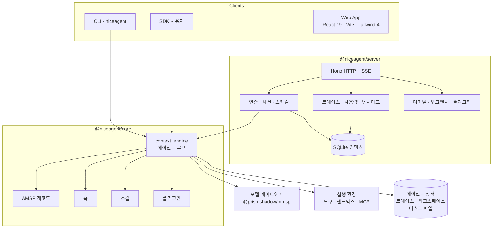
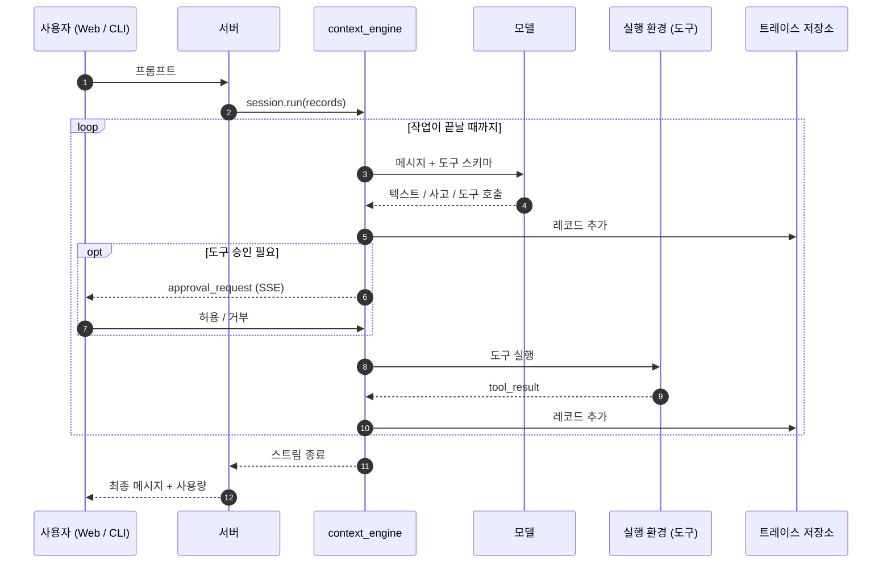

<p align="center">
  
</p>

<h1 align="center">NiceAgent</h1>

<p align="center"><strong>원하는 대로 shape 할 수 있는 범용·셀프 호스팅 에이전트 프레임워크 — 모델 비종속 추론 코어, 플러그인·스킬 라이브러리, Web App, CLI, 평가 하네스를 하나의 저장소에.</strong></p>

<p align="center">
  <a href="LICENSE"></a>
  = 24" />
  
  
  <a href="https://github.com/gqallen931/niceagent/discussions"></a>
</p>

<p align="center">
  <a href="README.md">简体中文</a> |
  <a href="README.en.md">English</a> |
  <a href="README.ja.md">日本語</a> |
  한국어 |
  <a href="README.fr.md">Français</a> |
  <a href="README.ru.md">Русский</a>
</p>

---

## NiceAgent란

NiceAgent는 **범용 에이전트 프레임워크**입니다. 모델 호출 주변의 기계 전체—실행 루프, 영속 세션, 도구 승인, 다수 사용자와 프로젝트를 처리하는 호스트, Web App, CLI, 플러그인 형식, 트레이스, 평가—를 제공하고, 제품을 차별화하는 부분만 직접 바꿀 수 있게 합니다.

특정 산업용 완제품이 아닙니다. 고정된 도메인도, 강제되는 워크플로도, 연결해야 하는 호스팅 서비스도 없습니다. 프레임워크는 당신의 머신에서 돌고, 모든 데이터는 당신의 디스크에 남으며, 확장은 문서화된 인터페이스로 이뤄집니다.

세 개의 층이 있고, 어느 하나만 따로 쓸 수 있습니다.

| 층 | 패키지 | 이런 때 | 바꿀 수 있는 것 |
| --- | --- | --- | --- |
| **엔진** | `@niceagent/core` + `@niceagent/amsp` | 자체 제품에 루프·도구·승인·트레이스만 필요할 때 | 모델, 도구, 실행 환경, 프롬프트, 훅, 저장 레이아웃 |
| **호스트** | `@niceagent/server` | 팀을 위해 계정·프로젝트·영속화까지 운영할 때 | 인증, 라우트, 스케줄, 샌드박스, 세션 런타임 |
| **제품 표면** | `@niceagent/web` + `@niceagent/cli` | 첫날부터 사람이 쓸 수 있는 형태가 필요할 때 | 페이지, 내비게이션, 문구, 테마, 브랜드, CLI 명령 |

## 대상

- **제품 팀**: 기존 제품에 에이전트 기능을 넣고 싶지만 세션·승인·스트리밍·트레이스를 처음부터 만들고 싶지 않은 팀.
- **플랫폼 팀**: 여러 팀에 에이전트를 제공해야 하며 계정·할당량·감사·격리가 필요한 팀.
- **에이전트 개발자·연구자**: 변경을 측정할 수 있는 완전한 런타임이 필요한 사람. 벤치마크, 루브릭, 케이스별 트레이스가 함께 제공됩니다.

## 실행 화면

<p align="center">
  
</p>

<p align="center"><sub>Web App: 스트리밍 응답, 도구 단계, 실행별 토큰·비용 계산, 프로젝트·세션 탐색.</sub></p>

<p align="center">
  
</p>

<p align="center"><sub>같은 데이터 루트를 사용하는 CLI: <code>niceagent --help</code>와 <code>niceagent session ls</code>.</sub></p>

| 에이전트 | 플러그인 |
| --- | --- |
|  |  |

| 모델 | 평가 |
| --- | --- |
|  |  |

## 포함된 것

| 구성 | 역할 |
| --- | --- |
| **코어 SDK** (`@niceagent/core`) | AMSP 레코드 기반 스트리밍 ReAct 루프, 교체 가능한 `LLMInterface` / `EnvironmentInterface`, 병렬 도구, 승인, 인터럽트, 자동 재연결, 컨텍스트 압축. |
| **서버** (`@niceagent/server`) | Hono HTTP + SSE, 다중 사용자 인증, 프로젝트 단위 인가, 세션 런타임, 스케줄, 서버 측 pty 터미널, 사용량 계산, 트레이스, 플러그인 설치, 벤치마크 실행. |
| **Web App** (`@niceagent/web`) | React 19 + Vite + Tailwind 4 SPA: 채팅, 에이전트, 플러그인, 모델, 머신, 비용 센터, 평가 센터, 조직 모드, 워크벤치, 터미널. |
| **CLI** (`@niceagent/cli`) | `niceagent`: REPL, 단일 실행, 설정, 세션·에이전트·프로젝트 관리, 비용, 스케줄, 에이전트 브라우저, `niceagent web`으로 플랫폼 일괄 실행. |
| **플러그인 라이브러리** | 29개 내장 플러그인 패키지: 스킬, 훅, MCP 서버, 워크벤치 페이지. 버전 관리와 에이전트별 설치 지원. |
| **평가 센터** | 벤치마크 케이스, 루브릭 채점, 케이스별 트레이스와 스코어보드. UI·CLI·에이전트에서 실행 가능. |

## 아키텍처

NiceAgent는 **루프**와 **호스트**를 분리합니다. 코어는 사고와 행동만 담당하고, 서버는 다수의 에이전트·사용자·프로젝트를 호스팅하며, Web App과 CLI는 같은 레코드 스트림의 두 렌더러입니다.



경계를 지키는 두 가지 원칙:

1. **엔진은 레코드를 말하고 전송을 말하지 않습니다.** 모델과 도구가 만드는 모든 것은 [AMSP](packages/amsp) 레코드이며, HTTP/SSE 서버·CLI·Web App은 그 스트림의 독자일 뿐입니다.
2. **파일이 진실, SQLite는 인덱스.** 에이전트 상태·트레이스·워크스페이스는 데이터 루트 아래 파일로 존재하고 SDK·CLI·서버가 공유합니다. DB는 조회가 필요한 것(사용자, 인가, 인덱스, 사용량)만 보관합니다.

실행 흐름:



모듈 경계, 확장 계약, 설계상의 트레이드오프는 [docs/ARCHITECTURE.md](docs/ARCHITECTURE.md)에 있습니다.

## 커스터마이징

아래는 모두 엔진을 수정하지 않고 쓸 수 있는 인터페이스입니다. 문제에 맞는 가장 작은 것을 고르세요.

| 하고 싶은 것 | 확장 지점 | 위치 |
| --- | --- | --- |
| 추론 방식을 바꾸기 | 시스템 프롬프트, `AGENTS.md`, 모델 설정 | 에이전트 설정 / 프로젝트 설정 |
| 능력 추가 | 도구 또는 MCP 서버 | 실행 환경 계층 / 플러그인 매니페스트 |
| 도메인 지식 주입 | 스킬(`SKILL.md`) | `plugins/*/skills/` |
| 라이프사이클에 반응 | 훅 패키지(`prompt` / `tool` / `stop`) | `plugins/*/hooks/` |
| 제품 페이지 추가 | 워크벤치 페이지 또는 서버 제공 페이지 | `plugins/*/workbenches/`, `packages/web/src/module.json` |
| 실행 격리 | 샌드박스 백엔드 | `plugins/sandbox-*` |
| 변경 측정 | 루브릭이 있는 벤치마크 케이스 | `benchmarks/` |
| 외형·문구·브랜드 변경 | 테마 토큰, 문구 사전, 로고, 앱 이름 | `packages/ui`, `packages/web/src/lib/` |
| 자체 제품 만들기 | SDK만 | `@niceagent/core` |

### SDK로 내장하기

서버도 UI도 CLI도 필요 없습니다. 한 번의 호출이 작업 전체를 구동합니다.

```ts
import { createAgent, isCompleteModelMessage, userText } from "@niceagent/core";

const agent = await createAgent({ agentId: "default_agent" });
const session = await agent.createSession({ workspaceDir: process.cwd() });

for await (const record of session.run([userText("hello.txt 파일을 만들고 hi 라고 써")], {
  approve: async () => "allow", // Human 경계: 도구 호출마다 한 번
})) {
  if (isCompleteModelMessage(record) && record.payload.type === "text") {
    process.stdout.write(record.payload.text);
  }
}
```

### 도구 추가

도구는 이름, 모델에 전달할 정의, 출력을 스트리밍하는 비동기 제너레이터를 가진 객체입니다. `Environment`는 수정할 필요가 없습니다.

```ts
import type { BuiltinTool } from "@niceagent/core";
import { partialToolCallOutput } from "@niceagent/amsp/records";

export function createJiraLookup(definition): BuiltinTool {
  return {
    name: "jira_lookup",
    definition, // { name, description, parameters, permission?, timeoutMs? }
    async *execute(args, ctx) {
      const issue = await jira.issue(String(args.key ?? ""));
      yield partialToolCallOutput({
        eventType: "delta",
        toolCallId: ctx.toolCallId,
        output: `# ${issue.key}: ${issue.title}`,
      });
      return { status: "completed" };
    },
  };
}
```

내장 도구 표([registry.ts](packages/core/src/environment/tools/registry.ts))에 팩토리를 등록하고 에이전트의 `tools.builtin`에서 켭니다. 컴파일하고 싶지 않은 능력은 MCP 서버로 연결할 수 있습니다.

### 플러그인 배포

플러그인은 평범한 npm 패키지이며 `niceagent` 블록만 특별합니다. 파일은 실행 시 읽히므로 스킬 수정이 즉시 반영됩니다.

```json
{
  "name": "@acme/warehouse-tools",
  "version": "0.1.0",
  "niceagent": {
    "title": "창고 도구",
    "category": "office-productivity",
    "skills": ["stock-check"],
    "mcp_servers": [{ "name": "wms", "command": "npx", "args": ["-y", "@acme/wms-mcp"] }]
  }
}
```

```
warehouse-tools/
  package.json
  icon.svg
  skills/stock-check/SKILL.md   # frontmatter: name, description, version (YYYY.MM.DD.N)
  hooks/stop.mjs                # stdin으로 JSON, stdout으로 JSON
```

훅은 stdin으로 JSON 하나를 받고 stdout으로 답합니다. stop 훅은 매 작업 후 호출됩니다.

```js
// stdin:  { "hook": "stop", "session_id": "...", "trace_path": "..." }
// stdout: { "decision": "continue", "input": "<다음 라운드>" } 또는 { "decision": "stop", "reason": "..." }
```

`plugins/` 아래 각 플러그인은 그대로 실행되는 완전한 예제입니다.

### 워크벤치 페이지 추가

워크벤치는 에이전트 전용 작은 UI를 채팅 안에 넣습니다. 빌드 단계가 없는 iframe 모듈입니다.

```json
{
  "name": "my-workbench",
  "type": "module",
  "niceagent": {
    "version": "2026.11.02.1",
    "modules": [{
      "name": "Workbench",
      "contributes": {
        "WebModule.sessionTabs": [{
          "id": "my.main",
          "key": "my-workbench",
          "title": "내 워크벤치",
          "renderer": { "iframe": { "src": "ui/index.html" } }
        }]
      }
    }]
  }
}
```

### 샌드박스 교체

도구 실행은 인터페이스입니다. `bwrap`·`seatbelt`·`WSL`·`DSH` 네 구현이 함께 제공되며, 새 구현(컨테이너, 원격 실행, 정책 전용 스텁)도 같은 계약으로 연결됩니다.

```ts
export interface SandboxBackend {
  readonly id: string;
  available(): Promise<boolean>;
  wrap(command: string): Promise<{ command: string; args: string[] }>;
}
```

### 평가 케이스 추가

벤치마크는 데이터입니다. 케이스마다 디렉터리 하나에 설명·루브릭·실행 설정을 둡니다.

```
benchmarks/my-benchmark/
  benchmark_config.toml
  CASE-001-refund-policy/
    statement/README.md
    rubric/README.md
```

### 외형·문구·브랜드

- 문구는 `packages/web/src/lib/strings.ts`(중국어)와 `strings-en.ts`(영어)에 있고 `appName`도 여기 있습니다.
- 로고는 `packages/web/public/niceagent-logo.svg`.
- 디자인 토큰은 `packages/ui/src/theme.css`. 세 테마 모두 CSS 변수입니다.
- 페이지는 `packages/web/src/module.json`에서 선언하고 `packages/web/src/router.tsx`가 렌더링합니다.

### 업그레이드하기 쉬운 포크를 위해

- 패키지는 **단일 버전**으로 함께 배포됩니다. 패키지 내부 경로가 아니라 패키지에 의존하세요.
- **AMSP 레코드는 추가만** 됩니다. 기존 레코드의 의미는 유지되므로 직접 만든 리더가 업그레이드를 넘어 동작합니다.
- **플러그인은 독립적으로 버전 관리**됩니다(`niceagent` 블록).
- `packages/core` 패치보다 플러그인·워크벤치를 우선하세요. 전자는 업그레이드에서 살아남고 후자는 남지 않습니다.

## 다른 프레임워크와의 비교

NiceAgent는 오케스트레이션 라이브러리가 아니라 하네스이므로 그래프 DSL보다 “나머지 스택 전체”와 경쟁합니다. 자세한 내용은 [docs/COMPARISON.md](docs/COMPARISON.md).

| | NiceAgent | LangGraph | CrewAI | OpenAI Agents SDK | Claude Agent SDK | OpenHands / SWE-agent |
| --- | --- | --- | --- | --- | --- | --- |
| 형태 | 셀프 호스팅 프레임워크 | 그래프 오케스트레이션 라이브러리 | 멀티 에이전트 라이브러리 | 에이전트 원시 요소 | 에이전트 루프 SDK | 코딩 에이전트 제품 |
| Web UI·인증·멀티 프로젝트 포함 | **예** | 아니요 | 아니요 | 아니요 | 아니요 | 일부(단일 사용자) |
| 동일 상태에 대한 CLI | **예** (`niceagent`) | 아니요 | 일부 | 아니요 | 일부 | 예 |
| 벤더 비종속 모델 계층 | **예** (게이트웨이 + 카탈로그 + OAuth) | 예 | 예 | OpenAI 중심 | Anthropic 중심 | 예 |
| 영속 트레이스·재생·재개 | **예** (추가 전용 레코드) | 체크포인트(저장소 직접) | 일부 | 내장 없음 | 세션 파일 | 예 |
| 버전 있는 플러그인·스킬 형식 | **예** (npm 패키지, 29개 내장) | 아니요 | 도구만 | 도구만 | 스킬/MCP | 도구만 |
| 샌드박스 실행 백엔드 | **예** (bwrap · seatbelt · WSL · DSH) | 아니요 | 아니요 | 아니요 | 아니요 | 컨테이너 |
| 내장 평가 하네스 | **예** (루브릭, 케이스, 스코어보드) | 아니요 | 아니요 | 아니요 | 아니요 | SWE-bench 형식 |
| 전체 스택 언어 | TypeScript (Node ≥ 24) | Python/JS | Python | Python/JS | Python/TS | Python |

이미 제품이 있고 그래프 원시 요소만 필요하다면 LangGraph나 OpenAI Agents SDK가 더 작은 의존성입니다. 영속화·승인·UI·CLI·플러그인·평가까지 포함한 프레임워크를 직접 shape 하고 싶다면 NiceAgent를 선택하세요.

## 빠른 시작

**요구 사항:** Node.js ≥ 24, pnpm ≥ 11.

```bash
git clone https://github.com/gqallen931/niceagent.git
cd niceagent
pnpm install
pnpm build
pnpm dev            # API :7368, Web App :7365
```

<http://localhost:7365/>를 엽니다. 새 데이터 루트에서는 서버가 터미널에 일회성 최초 로그인 링크(`/api/auth/claim?token=…`)를 출력합니다. 그 링크로 관리자 비밀번호를 설정하세요. 자동화 환경에서는 비밀번호를 고정할 수 있습니다.

```bash
NICEAGENT_SEED_ADMIN_PASSWORD='choose-something-long' pnpm dev
```

**모델** 화면에서 모델을 설정하고(OpenAI 호환 엔드포인트면 무엇이든 가능), 에이전트를 만든 뒤 대화를 시작하세요.

### CLI

```bash
pnpm niceagent --help                  # 소스에서 CLI 실행
pnpm niceagent run -m "이 저장소를 요약해 줘"    # 단일 작업
pnpm niceagent chat                    # 대화형 REPL (/compact, /clear, /exit)
pnpm niceagent session ls              # 데이터 루트의 세션 목록
pnpm niceagent cost --by model         # 토큰 사용량과 비용
pnpm niceagent server --port 7364      # 헤드리스 서버
```

공개 후에는 같은 명령을 전역 설치할 수 있습니다: `npm install -g @niceagent/cli`.

### Docker

```bash
docker build -t niceagent/niceagent:dev .
docker run -d -p 127.0.0.1:7364:7364 -v niceagent-data:/data niceagent/niceagent:dev
docker compose -f docker/compose.yaml up -d
docker compose logs niceagent          # 최초 로그인 링크
```

## 저장소 구조

```
packages/
  core/        에이전트 루프, 인터페이스, 훅, 스킬, 플러그인 로더, 트레이스 기록
  amsp/        모든 표면이 공유하는 레코드 프로토콜
  server/      HTTP + SSE 서버, 인증, 스토리지, 런타임, 터미널, 벤치마크
  web/         React Web App(채팅, 에이전트, 플러그인, 모델, 비용, 평가, 조직)
  cli/         `niceagent` 명령
  skills/      SKILL.md 파싱과 frontmatter 도우미
  hmr/         실행 중 플랫폼의 핫 업데이트 원시 요소
  ui/          공유 UI 원시 요소와 디자인 토큰
plugins/       플러그인 라이브러리(스킬, 훅, MCP, 워크벤치, 샌드박스)
benchmarks/    벤치마크 케이스와 루브릭
scripts/       빌드, 코드 생성, 저장소 도구
docs/          아키텍처, 비교, 스크린샷
```

## 설정

| 변수 | 의미 | 기본값 |
| --- | --- | --- |
| `NICEAGENT_HOME` | 데이터 루트(SDK·CLI·서버 공유) | `~/.niceagent/data` |
| `PORT` / `HOST` | 수신 포트 / 주소 | `7364` / `127.0.0.1` |
| `NICEAGENT_WEB_DIST` | 제공할 Web 빌드(SPA 폴백) | `../web/dist` |
| `NICEAGENT_WEB_DB` | SQLite 파일 | `<root>/web.db` |
| `NICEAGENT_SEED_ADMIN_PASSWORD` | 최초 관리자 비밀번호 고정(링크 출력 대신) | 미설정 |
| `NICEAGENT_TRUST_PROXY` | TLS 프록시 뒤에서 `x-forwarded-proto` 신뢰(`1`) | 미설정 |
| `NICEAGENT_UPDATE_CHECK` | 외부 릴리스 확인 비활성화(`off`) | 활성 |

모델 자격 증명은 각 프로젝트의 비공개 설정 파일(`0600`)에 저장되며 API에서는 항상 마스킹됩니다. 공급자 API 키는 환경 변수로도 제공할 수 있습니다.

## 보안

- 비밀번호는 `scrypt`를 사용합니다. 세션은 `auth_sessions`의 행이며 쿠키 토큰의 SHA-256만 저장하고 30일 슬라이딩 갱신합니다.
- 모든 쓰기 요청은 JSON Content-Type과 동일 출처를 요구하며, WebSocket은 추가로 `Origin`을 검증합니다.
- 터미널은 서버 OS 계정 권한의 셸입니다. SSH를 주고 싶지 않은 대상에게 터미널이 켜진 배포를 노출하지 마세요.
- 샌드박스 백엔드가 도구 실행을 제한합니다(제한 수준은 에이전트별 선택).
- 알려진 한계는 [.github/SECURITY.md](.github/SECURITY.md)에 있습니다.

## 기여

이슈와 풀 리퀘스트를 환영합니다. 먼저 [.github/CONTRIBUTING.md](.github/CONTRIBUTING.md)와 [행동 강령](.github/CODE_OF_CONDUCT.md)을 읽고, PR 전에 `pnpm lint`, `pnpm typecheck`, `pnpm test`를 실행하세요.

## 라이선스

Apache-2.0. [LICENSE](LICENSE)를 참고하세요. 서드파티 구성 요소와 라이선스는 [THIRD-PARTY-NOTICES.md](THIRD-PARTY-NOTICES.md)에 있습니다.
