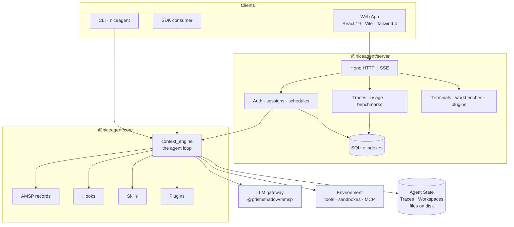
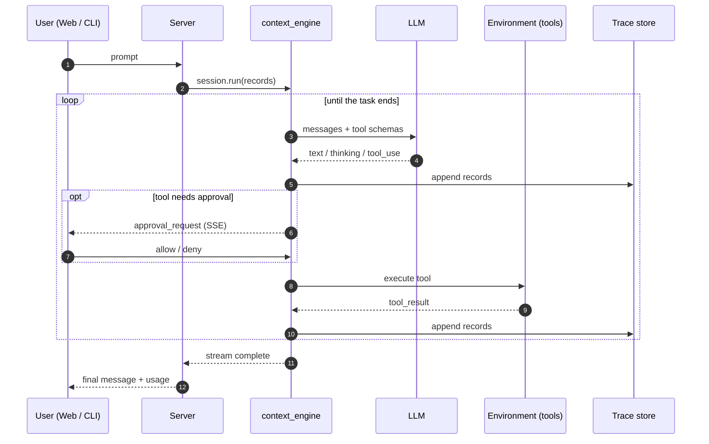

<p align="center">
  
</p>

<h1 align="center">NiceAgent</h1>

<p align="center"><strong>A general-purpose, self-hostable agent framework you can shape: a provider-agnostic reasoning core, a plugin and skill library, a Web App, a CLI and an evaluation harness — in one repository.</strong></p>

<p align="center">
  <a href="LICENSE"></a>
  = 24" />
  
  
  <a href="https://github.com/gqallen931/niceagent/discussions"></a>
</p>

<p align="center">
  English |
  <a href="README.zh.md">简体中文</a> |
  <a href="README.ja.md">日本語</a> |
  <a href="README.ko.md">한국어</a> |
  <a href="README.fr.md">Français</a> |
  <a href="README.ru.md">Русский</a>
</p>

---

## What NiceAgent is

NiceAgent is a **general-purpose agent framework**. It gives you the whole machine around a model
call — an execution loop, durable sessions, tool approvals, a host that serves many users and
projects, a Web App, a CLI, a plugin format, traces and evaluation — and then stays out of your way
while you replace the parts that make your product yours.

It is deliberately not a vertical product. There is no fixed domain, no workflow you must adopt and
no hosted service you must talk to: the framework runs on your machines, stores everything on your
disk, and is extended through documented interfaces rather than a fork of the core.

Three layers, and you can adopt any one of them on its own:

| Layer | Package | Use it when | What you can change |
| --- | --- | --- | --- |
| **Engine** | `@niceagent/core` + `@niceagent/amsp` | You are building your own product and want the loop, tools, approvals and traces | Models, tools, environment, prompts, hooks, storage layout |
| **Host** | `@niceagent/server` | You want to run agents for a team, with accounts, projects and persistence | Auth, routes, schedules, sandboxes, session runtime |
| **Product surface** | `@niceagent/web` + `@niceagent/cli` | You want something people can actually use on day one | Pages, navigation, strings, theme, branding, CLI commands |

## Who it is for

- **Product teams** that need agent capability inside an existing product and do not want to build
  sessions, approvals, streaming and trace history from scratch.
- **Platform teams** that have to host agents for several teams, with accounts, quotas, auditing and
  isolation.
- **Agent builders and researchers** who want a complete runtime to measure changes against —
  benchmark cases, rubrics and per-case traces are part of the framework.

## See it running

<p align="center">
  
</p>

<p align="center"><sub>The Web App: streaming turns, tool steps, per-run token and cost accounting, project and session navigation.</sub></p>

<p align="center">
  
</p>

<p align="center"><sub>The CLI, against the same data root: <code>niceagent --help</code> and <code>niceagent session ls</code>.</sub></p>

| Agents | Plugins |
| --- | --- |
|  |  |

| Models | Evaluation |
| --- | --- |
|  |  |

## What ships in the box

| Surface | What it does |
| --- | --- |
| **Core SDK** (`@niceagent/core`) | A streaming ReAct-style loop over AMSP records, swappable `LLMInterface` / `EnvironmentInterface`, concurrent tools, approvals, interrupts, automatic reconnect and context compaction. |
| **Server** (`@niceagent/server`) | Hono HTTP + SSE, multi-user auth, per-project authorization, session runtime, schedules, terminals (server-side ptys), usage accounting, traces, plugin installation, benchmark execution. |
| **Web App** (`@niceagent/web`) | React 19 + Vite + Tailwind 4 SPA: chat, agents, plugins, models, machines, cost center, evaluation center, organization mode, workbenches, terminal. |
| **CLI** (`@niceagent/cli`) | `niceagent` — REPL, one-shot runs, configuration, session/agent/project management, cost, schedules, the agent browser, and `niceagent web` to launch the whole platform. |
| **Plugin library** | A built-in library of 29 plugin packages: skills, hook packages, MCP servers and workbench pages, with versioning and per-agent installation. |
| **Evaluation Center** | Benchmark cases, rubric-based scoring, per-case traces and scoreboards — run from the UI, the CLI or an agent. |

## Architecture

NiceAgent separates **the loop** from **the host**. The engine knows how to think and act; the
server knows how to serve many agents, users and projects; the Web App and CLI are two renderers
over the same record stream.



Two rules keep the boundaries honest:

1. **The engine speaks records, not transport.** Everything the model and tools produce is an
   [AMSP](packages/amsp) record; the HTTP/SSE server, the terminal CLI and the Web App are just
   readers of that stream.
2. **Files are the source of truth; SQLite is an index.** Agent state, traces and workspaces live
   under the data root and are shared by SDK, CLI and server. The database holds only what must be
   queried (users, authorization, indexes, usage).

A full run, end to end:



Module boundaries, extension contracts and the reasoning behind them are in
[docs/ARCHITECTURE.md](docs/ARCHITECTURE.md).

## Customize NiceAgent

Everything below is an interface you can use without patching the engine. Pick the smallest one
that solves your problem.

| What you want | Extension point | Where it lives |
| --- | --- | --- |
| Change how the agent reasons | System prompt, `AGENTS.md`, model configuration | Agent settings / project config |
| Add a capability | A tool, or an MCP server | Environment layer / plugin manifest |
| Teach domain knowledge | A Skill (`SKILL.md`) | `plugins/*/skills/` |
| React to lifecycle events | A hook package (`prompt` / `tool` / `stop`) | `plugins/*/hooks/` |
| Add a product page | A workbench page, or a server-contributed page | `plugins/*/workbenches/`, `packages/web/src/module.json` |
| Isolate execution | A sandbox backend | `plugins/sandbox-*` |
| Measure changes | A benchmark case with a rubric | `benchmarks/` |
| Change the look, words or brand | Theme tokens, string dictionaries, logo, app name | `packages/ui`, `packages/web/src/lib/` |
| Ship your own product | The SDK alone | `@niceagent/core` |

### 1. Embed the engine as an SDK

The engine is usable without the server, the UI or the CLI. One call drives a whole task:

```ts
import { createAgent, isCompleteModelMessage, userText } from "@niceagent/core";

const agent = await createAgent({ agentId: "default_agent" });
const session = await agent.createSession({ workspaceDir: process.cwd() });

for await (const record of session.run([userText("Create hello.txt containing hi")], {
  // The Human boundary: called once per tool call.
  approve: async () => "allow",
})) {
  if (isCompleteModelMessage(record) && record.payload.type === "text") {
    process.stdout.write(record.payload.text);
  }
}
```

`session.run` streams records: model text, thinking, tool calls, tool output, usage and compaction
events. Deterministic replay is just reading the same records back, which is why resume works.

### 2. Add a tool

A tool is an object with a name, a definition handed to the model, and an async generator that
streams its output. Nothing in `Environment` needs to change:

```ts
import type { BuiltinTool } from "@niceagent/core";
import { partialToolCallOutput } from "@niceagent/amsp/records";

export function createJiraLookup(definition): BuiltinTool {
  return {
    name: "jira_lookup",
    definition, // { name, description, parameters, permission?, timeoutMs? }
    async *execute(args, ctx) {
      const issue = await jira.issue(String(args.key ?? ""));
      yield partialToolCallOutput({
        eventType: "delta",
        toolCallId: ctx.toolCallId,
        output: `# ${issue.key}: ${issue.title}\n\n${issue.body}`,
      });
      return { status: "completed" };
    },
  };
}
```

Register the factory in the built-in tool table
([registry.ts](packages/core/src/environment/tools/registry.ts)) and expose it in the agent's
`tools.builtin` configuration. For capabilities you do not want to compile in, point the agent at an
MCP server instead and let the plugin manifest declare it.

### 3. Package a plugin

A plugin is an ordinary npm package. Its `niceagent` block is the only special part, and its files
are read at runtime, so editing a skill takes effect immediately:

```json
{
  "name": "@acme/warehouse-tools",
  "version": "0.1.0",
  "niceagent": {
    "title": "Warehouse Tools",
    "category": "office-productivity",
    "skills": ["stock-check"],
    "mcp_servers": [{ "name": "wms", "command": "npx", "args": ["-y", "@acme/wms-mcp"] }]
  }
}
```

```
warehouse-tools/
  package.json
  icon.svg
  skills/
    stock-check/
      SKILL.md          # frontmatter: name, description, version (YYYY.MM.DD.N)
      reference/API.md  # optional attachments
  hooks/
    stop.mjs            # stdin JSON -> stdout JSON, see below
```

A hook receives one JSON object on stdin and answers on stdout. The stop hook, for example, is
consulted after every task:

```js
// stdin:  { "hook": "stop", "session_id": "...", "trace_path": "..." }
// stdout: { "decision": "continue", "input": "<next round>" }
//     or  { "decision": "stop", "reason": "..." }
```

Every built-in plugin under `plugins/` is a complete, runnable example; start from the smallest one
that resembles what you need.

### 4. Add a workbench page

A workbench gives an agent its own small UI, framed inside the chat. It is a module package with an
iframe contribution — no build step and no dependency on the Web App's internals:

```json
{
  "name": "my-workbench",
  "type": "module",
  "niceagent": {
    "version": "2026.11.02.1",
    "modules": [{
      "name": "Workbench",
      "contributes": {
        "WebModule.sessionTabs": [{
          "id": "my.main",
          "key": "my-workbench",
          "title": "My Workbench",
          "renderer": { "iframe": { "src": "ui/index.html" } }
        }]
      }
    }]
  }
}
```

The page talks to the host through the workbench SDK
([page-sdk.ts](packages/server/src/workbenches/page-sdk.ts)); state it writes under `state.json` is
versioned with the page.

### 5. Swap the execution sandbox

Tool execution is an interface. Four backends ship as references — `bwrap` (Linux), `seatbelt`
(macOS), `WSL` and `DSH` (Windows) — and each is a plugin implementing the same contract, so a new
one (a container runner, a remote executor, a policy-only stub) plugs in the same way:

```ts
export interface SandboxBackend {
  readonly id: string;
  available(): Promise<boolean>;
  wrap(command: string): Promise<{ command: string; args: string[] }>;
}
```

See [plugins/sandbox-bwrap](plugins/sandbox-bwrap) for the smallest complete implementation, and
the agent's `sandbox` setting for how a level is chosen.

### 6. Add an evaluation case

Benchmarks are data, not code. One directory per case, with a statement, a rubric and the
configuration that describes how to run it:

```
benchmarks/my-benchmark/
  benchmark_config.toml
  CASE-001-refund-policy/
    statement/README.md     # what the agent is asked to do
    rubric/README.md        # how the result is scored
```

Drop it in and it appears in the Evaluation Center; the CLI can run the same case
(`niceagent benchmark run`), and an agent can be asked to author cases itself.

### 7. Rebrand, localize, restyle the Web App

- **Words and brand**: `packages/web/src/lib/strings.ts` (Chinese) and `strings-en.ts` (English) hold
  every user-facing string, including `appName`; the logo is
  `packages/web/public/niceagent-logo.svg`.
- **Look and feel**: design tokens live in `packages/ui/src/theme.css`; the three shipped themes
  (Primer, Modern, Console) are CSS variables, so a fourth is a new block, not a fork.
- **Navigation**: pages are declared in `packages/web/src/module.json` and rendered by the registry in
  `packages/web/src/router.tsx`. A page that no longer fits your product is one entry removed.
- **Another language**: add a dictionary alongside `strings-en.ts` and register it in
  `packages/web/src/state/locale.tsx`.

### 8. Extend the server

Server routes are modules: each contributes `HttpModule.routes`, gets its dependencies injected at
boot, and is mounted under the authorization rules it declares. Add a file under
`packages/server/src/http/routes/`, register it in the session module's route table, and it travels
with the platform — no changes to the HTTP layer itself.

### Keeping your fork upgradeable

- Packages share **one version** and are released together; depend on the packages, not on file
  paths inside them.
- **AMSP records are additive.** New record kinds appear; existing ones keep their meaning, so a
  reader you wrote keeps working across upgrades.
- **Plugins are versioned independently** through their own `niceagent` block, which is what lets an
  installed plugin tell that its content changed.
- Prefer a plugin or a workbench over a patch to `packages/core`: the first two survive every
  upgrade, the third does not.

## How it compares

NiceAgent is a harness rather than an orchestration library, so it competes with "the rest of the
stack" more than with a graph DSL. The long version is in
[docs/COMPARISON.md](docs/COMPARISON.md); the short version:

| | NiceAgent | LangGraph | CrewAI | OpenAI Agents SDK | Claude Agent SDK | OpenHands / SWE-agent |
| --- | --- | --- | --- | --- | --- | --- |
| Shape | Self-hostable full framework | Graph orchestration library | Multi-agent crews library | Agent primitives library | Agent loop SDK | Coding-agent product |
| Ships a Web UI + auth + multi-project hosting | **Yes** | No | No | No | No | Partly (single-user) |
| Runs a local CLI against the same state | **Yes** (`niceagent`) | No | Partial | No | Partial | Yes |
| Provider-agnostic model layer | **Yes** (gateway + catalog + OAuth flows) | Yes | Yes | OpenAI-centric | Anthropic-centric | Yes |
| Durable traces, replay, resume | **Yes**, append-only records | Checkpointing (bring your own store) | Partial | No built-in store | Session files | Yes |
| Plugin / skill package format with versions | **Yes** (npm packages, 29 built in) | No | Tools only | Tools only | Skills/MCP | Tools only |
| Sandboxed execution backends | **Yes** (bwrap · seatbelt · WSL · DSH) | No | No | No | No | Containers |
| Built-in evaluation harness | **Yes** (rubrics, benchmark cases, scoreboards) | No | No | No | No | SWE-bench style |
| Language of the whole stack | TypeScript (Node ≥ 24) | Python/JS | Python | Python/JS | Python/TS | Python |

If you already have a product and only need a graph primitive, LangGraph or the OpenAI Agents SDK is
a smaller dependency. Pick NiceAgent when you want the framework — persistence, approvals, UI, CLI,
plugins and evaluation — to already exist and to be yours to shape.

## Quick start

**Requirements:** Node.js ≥ 24, pnpm ≥ 11.

```bash
git clone https://github.com/gqallen931/niceagent.git
cd niceagent
pnpm install
pnpm build
pnpm dev            # API on :7368, Web App on :7365
```

Open <http://localhost:7365/>. On a fresh data root, the server prints a one-time
first-login link (`/api/auth/claim?token=…`) in the terminal — open it to set the admin password.
For an automated environment, pin the password instead:

```bash
NICEAGENT_SEED_ADMIN_PASSWORD='choose-something-long' pnpm dev
```

Configure a model in **Models** (any OpenAI-compatible endpoint works), create an Agent, and start
chatting.

### CLI

```bash
pnpm niceagent --help                  # run the CLI from source
pnpm niceagent run -m "Summarise this repository"   # one Task, then exit
pnpm niceagent chat                    # interactive REPL (/compact, /clear, /exit)
pnpm niceagent session ls              # sessions in the data root
pnpm niceagent cost --by model         # token usage and cost
pnpm niceagent server --port 7364      # headless server
```

Once published, the same command installs globally: `npm install -g @niceagent/cli`.

### Docker

```bash
docker build -t niceagent/niceagent:dev .
docker run -d -p 127.0.0.1:7364:7364 -v niceagent-data:/data niceagent/niceagent:dev
docker compose -f docker/compose.yaml up -d
docker compose logs niceagent          # first-login link
```

## Repository layout

```
packages/
  core/        the agent loop, interfaces, hooks, skills, plugin loader, trace writer
  amsp/        the record protocol shared by every surface
  server/      HTTP + SSE server, auth, storage, runtime, terminals, benchmarks
  web/         React Web App (chat, agents, plugins, models, cost, evaluation, org)
  cli/         the `niceagent` command
  skills/      SKILL.md parsing and frontmatter helpers
  hmr/         hot-update primitives for the running platform
  ui/          shared UI primitives and design tokens
plugins/       the plugin library (skills, hooks, MCP servers, workbenches, sandboxes)
benchmarks/    benchmark cases and rubrics
scripts/       build, codegen and repository tooling
docs/          architecture, comparison, screenshots
```

## Configuration

| Variable | Meaning | Default |
| --- | --- | --- |
| `NICEAGENT_HOME` | Data root, shared by SDK, CLI and server | `~/.niceagent/data` |
| `PORT` / `HOST` | Server listen port / address | `7364` / `127.0.0.1` |
| `NICEAGENT_WEB_DIST` | Built Web App to host (SPA fallback) | `../web/dist` |
| `NICEAGENT_WEB_DB` | SQLite file | `<root>/web.db` |
| `NICEAGENT_SEED_ADMIN_PASSWORD` | Pin the first-boot admin password instead of printing a claim link | unset |
| `NICEAGENT_TRUST_PROXY` | Trust `x-forwarded-proto` behind a TLS proxy (`1`) | unset |
| `NICEAGENT_UPDATE_CHECK` | Disable the outbound release check (`off`) | on |

Model credentials live in each project's private config file (mode `0600`) and are always masked
over the API. Provider API keys can also come from environment variables.

## Security posture

- Passwords use `scrypt`; sessions are rows in `auth_sessions` holding only a SHA-256 of the cookie
  token, 30 days with sliding renewal.
- Every write requires a JSON content type and a same-origin request; WebSocket streams check
  `Origin` on top of the session cookie.
- Terminals are a shell as the server's OS account. Do not expose a deployment with terminals to
  accounts you would not give SSH.
- Sandbox backends confine tool execution; the confining levels are opt-in per Agent.
- Known limits are listed in [.github/SECURITY.md](.github/SECURITY.md).

## Contributing

Issues and pull requests are welcome. Start with [.github/CONTRIBUTING.md](.github/CONTRIBUTING.md),
follow the [Code of Conduct](.github/CODE_OF_CONDUCT.md), and run `pnpm lint`, `pnpm typecheck` and
`pnpm test` before opening a PR.

## License

Apache-2.0 — see [LICENSE](LICENSE). Third-party components and their licenses are listed in
[THIRD-PARTY-NOTICES.md](THIRD-PARTY-NOTICES.md).
