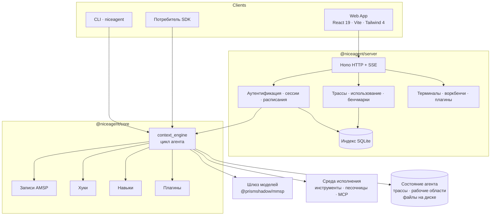
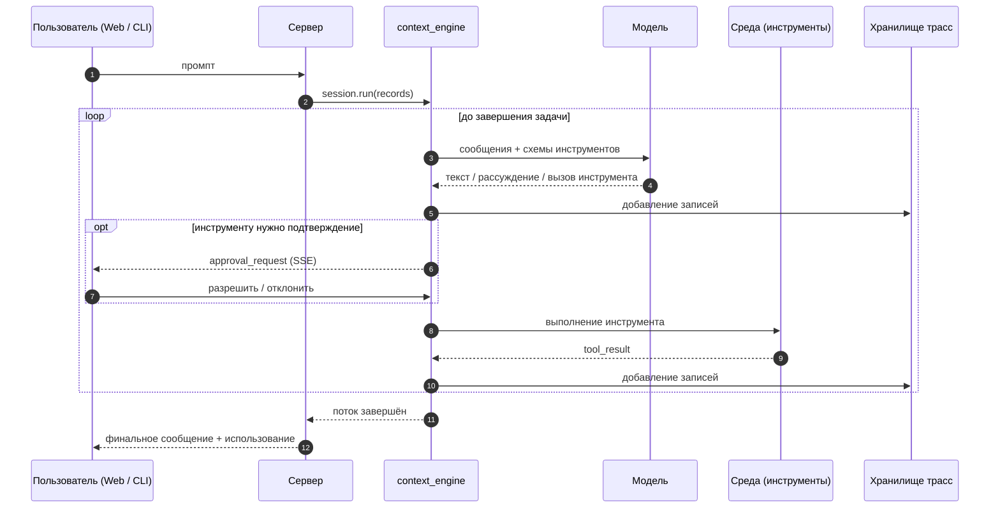

<p align="center">
  
</p>

<h1 align="center">NiceAgent</h1>

<p align="center"><strong>Универсальный самохостируемый фреймворк для агентов, который вы подстраиваете под себя: независимое от поставщика ядро рассуждений, библиотека плагинов и навыков, Web App, CLI и система оценки — в одном репозитории.</strong></p>

<p align="center">
  <a href="LICENSE"></a>
  = 24" />
  
  
  <a href="https://github.com/gqallen931/niceagent/discussions"></a>
</p>

<p align="center">
  <a href="README.md">简体中文</a> |
  <a href="README.en.md">English</a> |
  <a href="README.ja.md">日本語</a> |
  <a href="README.ko.md">한국어</a> |
  <a href="README.fr.md">Français</a> |
  Русский
</p>

---

## Что такое NiceAgent

NiceAgent — **универсальный фреймворк для агентов**. Он даёт всю механику вокруг вызова модели:
цикл исполнения, долговечные сессии, подтверждения инструментов, хост для множества
пользователей и проектов, Web App, CLI, формат плагинов, трассы и оценку — а затем отходит в
сторону, чтобы вы заменили только то, что делает ваш продукт особенным.

Это не готовый отраслевой продукт: нет фиксированного домена, обязательного рабочего процесса и
обязательного внешнего сервиса. Фреймворк работает на ваших машинах, хранит всё на вашем диске, а
расширяется через документированные интерфейсы, а не через патч ядра.

Три слоя, любой можно использовать отдельно:

| Слой | Пакет | Когда нужен | Что можно менять |
| --- | --- | --- | --- |
| **Движок** | `@niceagent/core` + `@niceagent/amsp` | Нужны цикл, инструменты, подтверждения и трассы в своём продукте | Модели, инструменты, среда, промпты, хуки, раскладка хранения |
| **Хост** | `@niceagent/server` | Нужно обслуживать агентов для команды: аккаунты, проекты, сохранность | Аутентификация, маршруты, расписания, песочницы, рантайм сессий |
| **Продуктовая поверхность** | `@niceagent/web` + `@niceagent/cli` | Нужен рабочий интерфейс с первого дня | Страницы, навигация, тексты, тема, бренд, команды CLI |

## Для кого

- **Продуктовые команды**, которым нужны агенты внутри существующего продукта без переписывания
  сессий, подтверждений, стриминга и истории.
- **Платформенные команды**, которые обслуживают несколько команд и нуждаются в аккаунтах,
  квотах, аудите и изоляции.
- **Разработчики и исследователи агентов**, которым нужен полный рантайм для измерения
  изменений: кейсы бенчмарков, рубрики и трассы по кейсам входят в комплект.

## Как это выглядит

<p align="center">
  
</p>

<p align="center"><sub>Web App: потоковые ответы, шаги инструментов, токены и стоимость каждого запуска, навигация по проектам и сессиям.</sub></p>

<p align="center">
  
</p>

<p align="center"><sub>CLI на том же корне данных: <code>niceagent --help</code> и <code>niceagent session ls</code>.</sub></p>

| Агенты | Плагины |
| --- | --- |
|  |  |

| Модели | Оценка |
| --- | --- |
|  |  |

## Что входит

| Компонент | Назначение |
| --- | --- |
| **Ядро SDK** (`@niceagent/core`) | Потоковый цикл ReAct на записях AMSP, заменяемые `LLMInterface` / `EnvironmentInterface`, параллельные инструменты, подтверждения, прерывания, автопереподключение и сжатие контекста. |
| **Сервер** (`@niceagent/server`) | Hono HTTP + SSE, многопользовательская аутентификация, авторизация по проектам, рантайм сессий, расписания, серверные pty-терминалы, учёт использования, трассы, установка плагинов, запуск бенчмарков. |
| **Web App** (`@niceagent/web`) | SPA на React 19 + Vite + Tailwind 4: чат, агенты, плагины, модели, машины, центр затрат, центр оценки, режим организации, воркбенчи, терминал. |
| **CLI** (`@niceagent/cli`) | `niceagent`: REPL, одиночный запуск, конфигурация, управление сессиями/агентами/проектами, стоимость, расписания, браузер агента и `niceagent web` для запуска всей платформы. |
| **Библиотека плагинов** | 29 встроенных пакетов: навыки, хуки, MCP-серверы и страницы воркбенчей, с версиями и установкой на агента. |
| **Центр оценки** | Кейсы бенчмарков, оценка по рубрикам, трассы по кейсам и таблицы результатов — из UI, CLI или самого агента. |

## Архитектура

NiceAgent разделяет **цикл** и **хост**. Ядро умеет думать и действовать; сервер обслуживает
множество агентов, пользователей и проектов; Web App и CLI — два представления одного потока
записей.



Два правила держат границы:

1. **Движок говорит записями, а не транспортом.** Всё, что производят модель и инструменты, —
   записи [AMSP](packages/amsp); HTTP/SSE-сервер, CLI и Web App лишь читают этот поток.
2. **Файлы — источник истины, SQLite — индекс.** Состояние агентов, трассы и рабочие области
   лежат в корне данных и разделяются SDK, CLI и сервером.

Полный путь выполнения:



Границы модулей, контракты расширения и компромиссы — в
[docs/ARCHITECTURE.md](docs/ARCHITECTURE.md).

## Настройка

Всё ниже — интерфейсы, которые не требуют правки ядра. Выбирайте наименьший, который решает задачу.

| Что нужно | Точка расширения | Где |
| --- | --- | --- |
| Изменить рассуждение | Системный промпт, `AGENTS.md`, настройки модели | Настройки агента / проекта |
| Добавить возможность | Инструмент или MCP-сервер | Слой среды / манифест плагина |
| Дать знания предметной области | Навык (`SKILL.md`) | `plugins/*/skills/` |
| Реагировать на события | Пакет хуков (`prompt` / `tool` / `stop`) | `plugins/*/hooks/` |
| Добавить страницу продукта | Страница воркбенча или страница от сервера | `plugins/*/workbenches/`, `packages/web/src/module.json` |
| Изолировать исполнение | Бэкенд песочницы | `plugins/sandbox-*` |
| Измерять изменения | Кейс бенчмарка с рубрикой | `benchmarks/` |
| Сменить вид, тексты, бренд | Токены темы, словари, логотип, имя приложения | `packages/ui`, `packages/web/src/lib/` |
| Сделать свой продукт | Только SDK | `@niceagent/core` |

### Встроить движок как SDK

Сервер, UI и CLI не нужны:

```ts
import { createAgent, isCompleteModelMessage, userText } from "@niceagent/core";

const agent = await createAgent({ agentId: "default_agent" });
const session = await agent.createSession({ workspaceDir: process.cwd() });

for await (const record of session.run([userText("Создай hello.txt с текстом hi")], {
  approve: async () => "allow", // Граница Human: раз на каждый вызов инструмента
})) {
  if (isCompleteModelMessage(record) && record.payload.type === "text") {
    process.stdout.write(record.payload.text);
  }
}
```

### Добавить инструмент

Инструмент — объект с именем, определением для модели и асинхронным генератором, который
стримит вывод. `Environment` менять не нужно:

```ts
import type { BuiltinTool } from "@niceagent/core";
import { partialToolCallOutput } from "@niceagent/amsp/records";

export function createJiraLookup(definition): BuiltinTool {
  return {
    name: "jira_lookup",
    definition, // { name, description, parameters, permission?, timeoutMs? }
    async *execute(args, ctx) {
      const issue = await jira.issue(String(args.key ?? ""));
      yield partialToolCallOutput({
        eventType: "delta",
        toolCallId: ctx.toolCallId,
        output: `# ${issue.key}: ${issue.title}`,
      });
      return { status: "completed" };
    },
  };
}
```

Зарегистрируйте фабрику в таблице встроенных инструментов
([registry.ts](packages/core/src/environment/tools/registry.ts)) и включите её в `tools.builtin`.

### Собрать плагин

Плагин — обычный npm-пакет; особый только блок `niceagent`. Файлы читаются во время работы,
поэтому правка навыка действует сразу.

```json
{
  "name": "@acme/warehouse-tools",
  "version": "0.1.0",
  "niceagent": {
    "title": "Инструменты склада",
    "category": "office-productivity",
    "skills": ["stock-check"],
    "mcp_servers": [{ "name": "wms", "command": "npx", "args": ["-y", "@acme/wms-mcp"] }]
  }
}
```

```
warehouse-tools/
  package.json
  icon.svg
  skills/stock-check/SKILL.md   # frontmatter: name, description, version (YYYY.MM.DD.N)
  hooks/stop.mjs                # JSON на stdin, JSON на stdout
```

Хук получает один JSON на stdin и отвечает на stdout; хук `stop` вызывается после каждой задачи:

```js
// stdin:  { "hook": "stop", "session_id": "...", "trace_path": "..." }
// stdout: { "decision": "continue", "input": "<следующий раунд>" } или { "decision": "stop", "reason": "..." }
```

Каждый плагин в `plugins/` — полный рабочий пример.

### Добавить страницу воркбенча

Воркбенч даёт агенту собственный небольшой UI внутри чата: модуль с iframe, без шага сборки.

```json
{
  "name": "my-workbench",
  "type": "module",
  "niceagent": {
    "version": "2026.11.02.1",
    "modules": [{
      "name": "Workbench",
      "contributes": {
        "WebModule.sessionTabs": [{
          "id": "my.main",
          "key": "my-workbench",
          "title": "Мой воркбенч",
          "renderer": { "iframe": { "src": "ui/index.html" } }
        }]
      }
    }]
  }
}
```

### Заменить песочницу

Исполнение инструментов — интерфейс. Четыре бэкенда поставляются как примеры — `bwrap`,
`seatbelt`, `WSL` и `DSH` — и новый (контейнер, удалённое исполнение, только политика) подключается
так же:

```ts
export interface SandboxBackend {
  readonly id: string;
  available(): Promise<boolean>;
  wrap(command: string): Promise<{ command: string; args: string[] }>;
}
```

### Добавить кейс оценки

Бенчмарки — это данные: каталог на кейс, с постановкой, рубрикой и конфигурацией.

```
benchmarks/my-benchmark/
  benchmark_config.toml
  CASE-001-refund-policy/
    statement/README.md
    rubric/README.md
```

### Бренд, тексты, тема

- Тексты — в `packages/web/src/lib/strings.ts` (китайский) и `strings-en.ts` (английский), включая
  `appName`; логотип — `packages/web/public/niceagent-logo.svg`.
- Токены дизайна — в `packages/ui/src/theme.css`; три темы — это CSS-переменные, четвёртая — новый
  блок.
- Страницы объявляются в `packages/web/src/module.json` и рендерятся
  `packages/web/src/router.tsx`.

### Чтобы форк было легко обновлять

- Пакеты выходят **одной версией**; зависьте от пакетов, а не от путей внутри них.
- **Записи AMSP только добавляются** — ваши читатели продолжают работать.
- **Плагины версионируются независимо** через блок `niceagent`.
- Предпочитайте плагин или воркбенч патчу `packages/core`: первые переживают обновления.

## Сравнение

NiceAgent — это каркас, а не библиотека оркестрации, поэтому он конкурирует со «всем остальным
стеком». Полная версия — [docs/COMPARISON.md](docs/COMPARISON.md).

| | NiceAgent | LangGraph | CrewAI | OpenAI Agents SDK | Claude Agent SDK | OpenHands / SWE-agent |
| --- | --- | --- | --- | --- | --- | --- |
| Форма | Самохостируемый фреймворк | Библиотека графов | Мультиагентная библиотека | Примитивы агентов | SDK цикла | Продукт-агент для кода |
| Web UI + auth + мультипроектность | **Да** | Нет | Нет | Нет | Нет | Частично (один пользователь) |
| CLI поверх того же состояния | **Да** (`niceagent`) | Нет | Частично | Нет | Частично | Да |
| Независимый от поставщика слой моделей | **Да** (шлюз + каталог + OAuth) | Да | Да | С уклоном в OpenAI | С уклоном в Anthropic | Да |
| Долговечные трассы, воспроизведение, возобновление | **Да** (append-only записи) | Чекпоинты (хранилище своё) | Частично | Нет встроенного | Файлы сессий | Да |
| Версионируемый формат плагинов/навыков | **Да** (npm-пакеты, 29 встроенных) | Нет | Только инструменты | Только инструменты | Навыки/MCP | Только инструменты |
| Песочницы исполнения | **Да** (bwrap · seatbelt · WSL · DSH) | Нет | Нет | Нет | Нет | Контейнеры |
| Встроенная оценка | **Да** (рубрики, кейсы, таблицы) | Нет | Нет | Нет | Нет | В стиле SWE-bench |
| Язык всего стека | TypeScript (Node ≥ 24) | Python/JS | Python | Python/JS | Python/TS | Python |

Если продукт уже есть и нужен только графовый примитив, LangGraph или OpenAI Agents SDK — меньшая
зависимость. Выбирайте NiceAgent, когда каркас — персистентность, подтверждения, UI, CLI, плагины и
оценка — должен уже существовать и быть вашим.

## Быстрый старт

**Требования:** Node.js ≥ 24, pnpm ≥ 11.

```bash
git clone https://github.com/gqallen931/niceagent.git
cd niceagent
pnpm install
pnpm build
pnpm dev            # API на :7368, Web App на :7365
```

Откройте <http://localhost:7365/>. На новом корне данных сервер печатает одноразовую ссылку
первого входа (`/api/auth/claim?token=…`). Для автоматизации пароль можно зафиксировать:

```bash
NICEAGENT_SEED_ADMIN_PASSWORD='choose-something-long' pnpm dev
```

Настройте модель на странице **Модели** (подойдёт любой OpenAI-совместимый эндпоинт), создайте
агента и начинайте диалог.

### CLI

```bash
pnpm niceagent --help                  # запуск CLI из исходников
pnpm niceagent run -m "Суммируй этот репозиторий"   # одна задача и выход
pnpm niceagent chat                    # REPL (/compact, /clear, /exit)
pnpm niceagent session ls              # сессии в корне данных
pnpm niceagent cost --by model         # токены и стоимость
pnpm niceagent server --port 7364      # сервер без интерфейса
```

После публикации та же команда ставится глобально: `npm install -g @niceagent/cli`.

### Docker

```bash
docker build -t niceagent/niceagent:dev .
docker run -d -p 127.0.0.1:7364:7364 -v niceagent-data:/data niceagent/niceagent:dev
docker compose -f docker/compose.yaml up -d
docker compose logs niceagent          # ссылка первого входа
```

## Структура репозитория

```
packages/
  core/        цикл агента, интерфейсы, хуки, навыки, загрузчик плагинов, запись трасс
  amsp/        протокол записей, общий для всех поверхностей
  server/      HTTP + SSE сервер, auth, хранилище, рантайм, терминалы, бенчмарки
  web/         React Web App (чат, агенты, плагины, модели, затраты, оценка, организация)
  cli/         команда `niceagent`
  skills/      разбор SKILL.md и помощники frontmatter
  hmr/         примитивы горячего обновления работающей платформы
  ui/          общие UI-примитивы и токены дизайна
plugins/       библиотека плагинов (навыки, хуки, MCP, воркбенчи, песочницы)
benchmarks/    кейсы бенчмарков и рубрики
scripts/       сборка, кодогенерация, инструменты репозитория
docs/          архитектура, сравнение, скриншоты
```

## Конфигурация

| Переменная | Значение | По умолчанию |
| --- | --- | --- |
| `NICEAGENT_HOME` | Корень данных (общий для SDK, CLI и сервера) | `~/.niceagent/data` |
| `PORT` / `HOST` | Порт / адрес прослушивания | `7364` / `127.0.0.1` |
| `NICEAGENT_WEB_DIST` | Сборка Web для раздачи (SPA fallback) | `../web/dist` |
| `NICEAGENT_WEB_DB` | Файл SQLite | `<root>/web.db` |
| `NICEAGENT_SEED_ADMIN_PASSWORD` | Задать пароль администратора при первом запуске вместо ссылки | не задано |
| `NICEAGENT_TRUST_PROXY` | Доверять `x-forwarded-proto` за TLS-прокси (`1`) | не задано |
| `NICEAGENT_UPDATE_CHECK` | Отключить исходящую проверку обновлений (`off`) | включено |

Учётные данные моделей хранятся в приватном конфиге проекта (права `0600`) и всегда маскируются
в API. Ключи провайдеров также можно задавать переменными окружения.

## Безопасность

- Пароли — `scrypt`; сессия — строка в `auth_sessions`, где хранится только SHA-256 токена cookie,
  30 дней со скользящим продлением.
- Любая запись требует JSON Content-Type и same-origin; WebSocket-потоки дополнительно проверяют
  `Origin`.
- Терминалы — это shell с правами ОС-аккаунта сервера. Не открывайте развёртывание с терминалами
  тем, кому вы не дали бы SSH.
- Песочницы ограничивают выполнение инструментов; строгие уровни включаются на агента.
- Известные ограничения — [.github/SECURITY.md](.github/SECURITY.md).

## Участие

Issues и pull requests приветствуются. Начните с [.github/CONTRIBUTING.md](.github/CONTRIBUTING.md),
соблюдайте [Кодекс поведения](.github/CODE_OF_CONDUCT.md) и запускайте `pnpm lint`,
`pnpm typecheck`, `pnpm test` перед PR.

## Лицензия

Apache-2.0 — см. [LICENSE](LICENSE). Сторонние компоненты и их лицензии перечислены в
[THIRD-PARTY-NOTICES.md](THIRD-PARTY-NOTICES.md).
