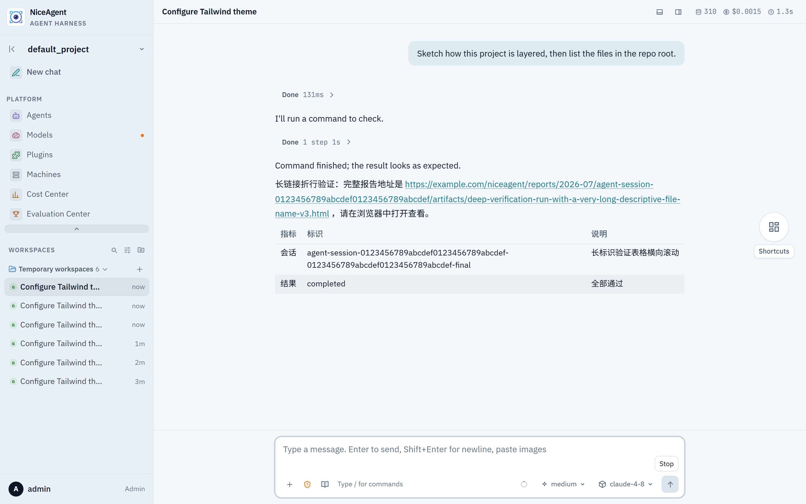
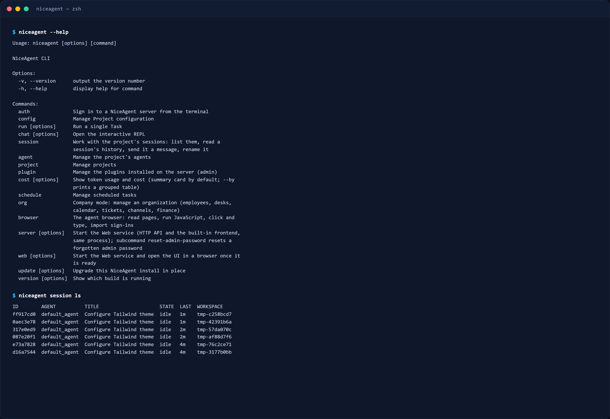
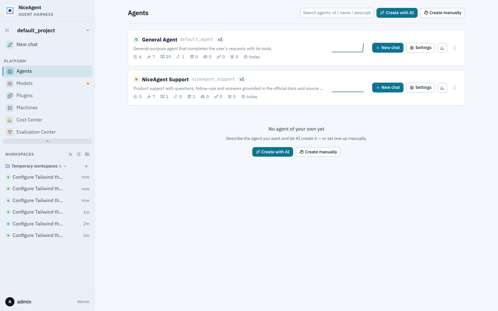
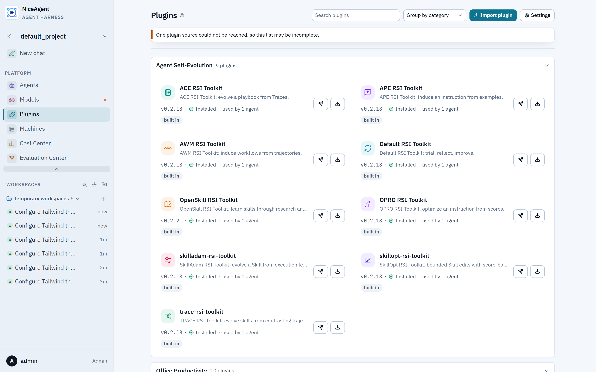
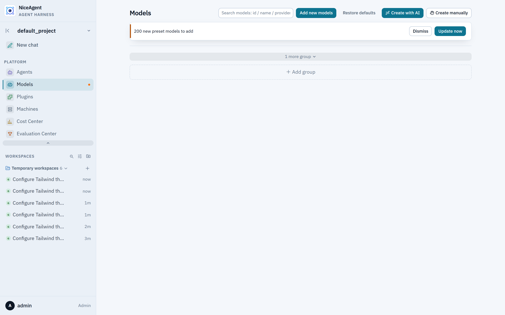
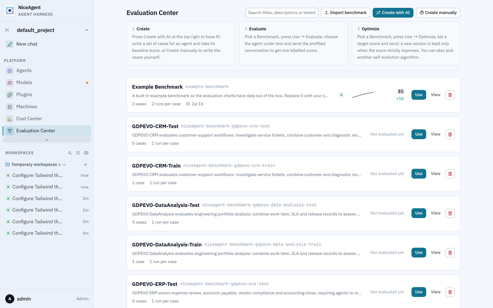
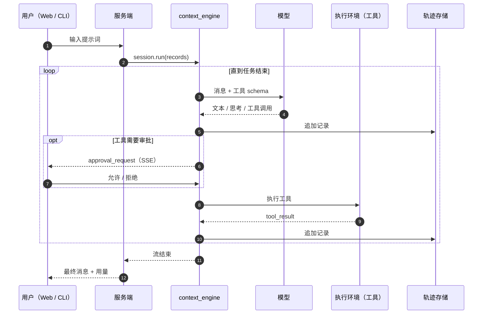

<p align="center">
  
</p>

<h1 align="center">NiceAgent</h1>

<p align="center"><strong>一个通用、可自托管、可自由定制的智能体框架：与模型供应商无关的推理内核、插件与技能库、Web App、CLI 与评测体系，全部在同一仓库内。</strong></p>

<p align="center">
  <a href="LICENSE"></a>
  = 24" />
  
  
  <a href="https://github.com/gqallen931/niceagent/discussions"></a>
</p>

<p align="center">
  <a href="README.md">English</a> |
  简体中文 |
  <a href="README.ja.md">日本語</a> |
  <a href="README.ko.md">한국어</a> |
  <a href="README.fr.md">Français</a> |
  <a href="README.ru.md">Русский</a>
</p>

---

## NiceAgent 是什么

NiceAgent 是一个**通用智能体框架**。它把一次模型调用周围那整套机器交给你——执行循环、可持久化的会话、工具审批、能同时服务多用户与多项目的宿主、Web App、CLI、插件格式、轨迹与评测——然后把舞台让出来，由你替换那些真正让产品与众不同的部分。

它刻意不是某个垂直行业的成品：没有固定业务域，没有必须接受的工作流，也没有必须连接的外部托管服务。框架跑在你自己的机器上，数据全部存在你自己的磁盘里，扩展通过有文档的接口完成，而不是去改内核。

三层结构，任何一层都可以单独采用：

| 层 | 包 | 适用场景 | 你可以改什么 |
| --- | --- | --- | --- |
| **内核** | `@niceagent/core` + `@niceagent/amsp` | 你在做自己的产品，只需要循环、工具、审批与轨迹 | 模型、工具、执行环境、提示词、钩子、存储布局 |
| **宿主** | `@niceagent/server` | 你要为团队运行智能体，需要账号、项目与持久化 | 鉴权、路由、定时任务、沙箱、会话运行时 |
| **产品表面** | `@niceagent/web` + `@niceagent/cli` | 你希望开箱即用，用户当天就能上手 | 页面、导航、文案、主题、品牌、CLI 命令 |

## 适合谁

- **产品团队**：需要在既有产品里嵌入智能体能力，又不想从零实现会话、审批、流式输出与轨迹。
- **平台团队**：要为多个团队托管智能体，需要账号、配额、审计与隔离。
- **智能体开发者与研究者**：需要一个完整运行时来量化每次改动——基准用例、评分规则与逐用例轨迹都在框架内。

## 运行效果

<p align="center">
  
</p>

<p align="center"><sub>Web App：流式回复、工具步骤、单次运行的 token 与成本核算、项目与会话导航。</sub></p>

<p align="center">
  
</p>

<p align="center"><sub>CLI，连接同一个数据根：<code>niceagent --help</code> 与 <code>niceagent session ls</code>。</sub></p>

| 智能体 | 插件 |
| --- | --- |
|  |  |

| 模型 | 评测 |
| --- | --- |
|  |  |

## 框架包含什么

| 组成 | 作用 |
| --- | --- |
| **核心 SDK**（`@niceagent/core`） | 基于 AMSP 记录的流式 ReAct 循环，可替换的 `LLMInterface` / `EnvironmentInterface`，并发工具、审批、打断、自动重连与上下文压缩。 |
| **服务端**（`@niceagent/server`） | Hono HTTP + SSE、多用户鉴权、项目级授权、会话运行时、定时任务、服务端终端（pty）、用量核算、轨迹、插件安装、基准执行。 |
| **Web App**（`@niceagent/web`） | React 19 + Vite + Tailwind 4 单页应用：聊天、智能体、插件、模型、机器、成本中心、评测中心、组织模式、工作台、终端。 |
| **CLI**（`@niceagent/cli`） | `niceagent`：交互式 REPL、单次任务、配置管理、会话/智能体/项目管理、成本、定时任务、智能体浏览器，以及 `niceagent web` 一键启动整套平台。 |
| **插件库** | 29 个内置插件包：技能、钩子包、MCP 服务与工作台页面，带版本与按智能体安装。 |
| **评测中心** | 基准用例、基于评分规则的打分、逐用例轨迹与记分板——可在界面、CLI 或由智能体自身运行。 |

## 核心亮点：能构建 Agent，也能改进自己

这个内核不只是拿来嵌入的——它强到可以作用于自身。下面两个可运行示例把这件事完整演示了一遍，
只用公开 SDK 和一个本地的开源权重模型（由 Ollama 提供）：不调用云端 API，数据也不离开本机。

| 示例 | 演示什么 | 路径 |
| --- | --- | --- |
| **用一个 Agent 构建另一个 Agent** | Agent 依据一段大白话需求写出另一个 Agent，然后立刻运行它 | [`examples/build-agent-with-agent`](examples/build-agent-with-agent) |
| **自我改进的 Agent** | Agent 诊断自己的失败、重写自己的 `AGENTS.md`，只在平均分提升时保留改动 | [`examples/self-improving-agent`](examples/self-improving-agent) |

两者合起来正好闭环：Agent 定义是框架可以**生产**的数据，也是框架可以**改进**的数据——因为它自始至终
都是文件、轨迹和评分规则。

### 1. 用一个 Agent 构建另一个 Agent

[`examples/build-agent-with-agent/build-agent.ts`](examples/build-agent-with-agent/build-agent.ts)
在一个脚本里跑两个阶段：

1. **构建** —— `default_agent` 由 `agent-initialization` 技能驱动
   （[plugins/agent-development/skills/agent-initialization](plugins/agent-development/skills/agent-initialization)），
   从一段需求里搭出一个新智能体：智能体目录、复制来的 `system_config.yaml`（带名称与描述），以及一份
   把规则写清楚的 `AGENTS.md`。
2. **运行** —— 加载刚创建的 `commit-helper`，交给它第一个任务。它只依赖构建者刚刚写下的
   `AGENTS.md` 作答——这正是“生成的文件确实塑造了行为”的证据。

**价值所在**

- **智能体是数据，不是代码。** 一个目录加一份 `AGENTS.md` 就是全部定义，所以“创建一个智能体”只是会话内
  的一次工具调用：没有脚手架脚本、没有构建步骤、不需要部署。
- **构建者与被构建者共用同一套运行时。** 同一个 SDK、审批回调、沙箱与轨迹格式覆盖两者，你对其中一个的
  观察同样适用于另一个。
- **产出是一等公民。** 它会出现在 Web App 里，可以手工编辑，也和项目里其他文件一样纳入版本管理。
- **人只负责机械层面的收尾。** 设计交给模型；YAML 缩进、转义这类小失误以纯文本和轨迹形式暴露，几秒即可
  修正。

```bash
# 一次性：在本地提供开源权重模型（ROCm，AMD GPU 同样可用）
ollama serve & ollama pull qwen3.6:35b
niceagent config model add --model-id qwen3.6:35b \
  --provider custom --client-type openai \
  --base-url http://localhost:11434/v1 --api-key ollama --set-default

pnpm install && pnpm build
pnpm --dir examples/build-agent-with-agent start
# 或：npx tsx examples/build-agent-with-agent/build-agent.ts
```

第二阶段会打印类似这样的结果：

```text
fix(payment): add retry-with-backoff for transient gateway 503 errors

Transient 503 responses from the payment gateway were causing checkout
failures during peak traffic. Retry with exponential backoff gives the
gateway time to recover, preventing spurious user-facing errors.
```

### 2. 自我改进的 Agent

[`examples/self-improving-agent`](examples/self-improving-agent) 在智能体自己的定义上跑
**评估 → 诊断 → 编辑 → 重新评估**循环，只有平均分提升时才保留这一轮改动。

| 脚本 | 演示什么 | 由谁编辑 `AGENTS.md` |
| --- | --- | --- |
| `self-improve.ts` | 评分闭环的微缩版——诚实的基线 | **脚本**（硬编码） |
| `self-evolve.ts` | 真正的单轮自我进化 | **Agent** 自己 |
| `self-evolve-recursive.ts` | 多轮递归——`start` 对应的主线 | **Agent** 自己，连续两轮 |

任务刻意围绕一个**信息缺口**设计：把笔记总结进 `summary.md` 不难，但团队的汇报约定——一行 marker、
`# Report: <subject>` 标题、一行 `Classification:`、`Reviewed-by:` 页脚——只存在于 `AGENTS.md` 里，
无法从任务本身推断。评分规则有 10 个原子分点：5 个内容点任何有能力的模型都能拿到，另外 5 个只能来自
约定。`AGENTS.md` 为空时，即使强模型也会稳定停在 5/10——缺的那一半是**知识**，不是**能力**。

**价值所在**

- **改进是产出的，不是写死的。** 脚本只提供失败信号和一份通过范例；Agent 自己读出缺失的规则，并写进
  自己的身份文件。
- **递归是真的状态传递。** 第二轮从第一轮写下的 `AGENTS.md` 出发继续精炼
  （`state_{n+1} = agent.reflect(state_n, evidence)`）：结构从一份范例学到，固定常量则从多份范例中锁定。
- **指标可证伪。** 评分规则就是普通代码，每次运行都有轨迹，因此没能提分的一轮会被回滚——这个循环有目标
  函数，而不是一段叙事。
- **形态可迁移。** 任何需要 Agent 吸收的约定——仓库风格、团队评审规则、私有评分标准——都可以套用这个
  结构，评分器交给 `agent-evaluation`。

```bash
pnpm --dir examples/self-improving-agent start     # 递归主线
# 单轮：      npx tsx examples/self-improving-agent/self-evolve.ts
# 评分基线：  npx tsx examples/self-improving-agent/self-improve.ts
```

典型轨迹，把结构收益与常量锁定分开看：

```text
N    (基线):       4.80/10     # AGENTS.md 为空——约定分全部丢失
N+1  (结构):       6.60/10     # 从一份通过范例学到格式
N+2  (常量):       9.80/10     # 从三份范例锁定字面常量
两轮自我编写的改动，单调上升。✔
```

具体数字每次运行会有波动，方向才是重点。各自的 README 还写清了环境准备、预期输出与诚实的边界，包括
弱模型为何可能倒退，以及那次回滚恰恰说明循环在正确工作。

## 架构

NiceAgent 把**循环**与**宿主**分开：内核只负责思考与行动；服务端负责托管多智能体、多用户、多项目；Web App 与 CLI 是同一记录流的两个渲染器。

```mermaid
flowchart TB
  subgraph Clients
    W[Web App<br/>React 19 · Vite · Tailwind 4]
    C[CLI · niceagent]
    S[SDK 调用方]
  end

  subgraph Server["@niceagent/server"]
    H[Hono HTTP + SSE]
    A[鉴权 · 会话 · 定时任务]
    T[轨迹 · 用量 · 基准]
    P[终端 · 工作台 · 插件]
    DB[(SQLite 索引)]
  end

  subgraph Core["@niceagent/core"]
    E[context_engine<br/>智能体循环]
    R[AMSP 记录]
    Hk[钩子]
    Sk[技能]
    Pl[插件]
  end

  M[模型网关<br/>@prismshadow/mmsp]
  X[执行环境<br/>工具 · 沙箱 · MCP]
  F[(智能体状态<br/>轨迹 · 工作区<br/>磁盘文件)]

  W --> H
  C --> E
  S --> E
  H --> A --> E
  H --> T
  H --> P
  E --> R
  E --> M
  E --> X
  E --> Hk
  E --> Sk
  E --> Pl
  E --> F
  A --> DB
  T --> DB
```

两条规则守住了边界：

1. **内核只说记录，不说传输。** 模型与工具产生的一切都是 [AMSP](packages/amsp) 记录；HTTP/SSE 服务端、终端 CLI 与 Web App 都只是这条流的读者。
2. **文件是事实来源，SQLite 是索引。** 智能体状态、轨迹与工作区都以文件形式存放在数据根下，被 SDK、CLI 与服务端共享；数据库只保存必须查询的部分（用户、授权、索引、用量）。

一次完整运行的端到端流程：



模块边界、扩展契约及其取舍见 [docs/ARCHITECTURE.md](docs/ARCHITECTURE.md)。

## 定制开发

下面每一项都是不需要改内核就能使用的接口。按问题大小挑最小的一层即可。

| 你想做的事 | 扩展点 | 位置 |
| --- | --- | --- |
| 改变推理方式 | 系统提示词、`AGENTS.md`、模型配置 | 智能体设置 / 项目配置 |
| 增加一种能力 | 工具，或 MCP 服务 | 执行环境层 / 插件清单 |
| 注入领域知识 | 技能（`SKILL.md`） | `plugins/*/skills/` |
| 响应生命周期事件 | 钩子包（`prompt` / `tool` / `stop`） | `plugins/*/hooks/` |
| 增加一个产品页面 | 工作台页面，或服务端贡献页面 | `plugins/*/workbenches/`、`packages/web/src/module.json` |
| 隔离执行 | 沙箱后端 | `plugins/sandbox-*` |
| 量化改动效果 | 带评分规则的基准用例 | `benchmarks/` |
| 换外观、文案或品牌 | 主题令牌、文案字典、Logo、应用名 | `packages/ui`、`packages/web/src/lib/` |
| 做自己的产品 | 只用 SDK | `@niceagent/core` |

### 1. 用 SDK 嵌入内核

内核不依赖服务端、界面或 CLI，一次调用即可驱动完整任务：

```ts
import { createAgent, isCompleteModelMessage, userText } from "@niceagent/core";

const agent = await createAgent({ agentId: "default_agent" });
const session = await agent.createSession({ workspaceDir: process.cwd() });

for await (const record of session.run([userText("创建 hello.txt，内容为 hi")], {
  // Human 边界：每个工具调用都会问一次
  approve: async () => "allow",
})) {
  if (isCompleteModelMessage(record) && record.payload.type === "text") {
    process.stdout.write(record.payload.text);
  }
}
```

`session.run` 流出的是记录：模型文本、思考、工具调用、工具输出、用量与压缩事件。所谓「恢复会话」，就是把这些记录重新读一遍——这也是恢复不会走样的原因。

### 2. 增加一个工具

工具就是一个对象：名字、交给模型的定义、以及一个流式输出的异步生成器。`Environment` 不需要任何改动：

```ts
import type { BuiltinTool } from "@niceagent/core";
import { partialToolCallOutput } from "@niceagent/amsp/records";

export function createJiraLookup(definition): BuiltinTool {
  return {
    name: "jira_lookup",
    definition, // { name, description, parameters, permission?, timeoutMs? }
    async *execute(args, ctx) {
      const issue = await jira.issue(String(args.key ?? ""));
      yield partialToolCallOutput({
        eventType: "delta",
        toolCallId: ctx.toolCallId,
        output: `# ${issue.key}: ${issue.title}\n\n${issue.body}`,
      });
      return { status: "completed" };
    },
  };
}
```

在内置工具表（[registry.ts](packages/core/src/environment/tools/registry.ts)）注册工厂，并在智能体的 `tools.builtin` 里启用。不想编译进主程序的能力，可以改为对接 MCP 服务，由插件清单声明。

### 3. 打包一个插件

插件就是普通的 npm 包，只有 `niceagent` 字段是特殊的；文件在运行时读取，因此改技能立即生效：

```json
{
  "name": "@acme/warehouse-tools",
  "version": "0.1.0",
  "niceagent": {
    "title": "仓储工具",
    "category": "office-productivity",
    "skills": ["stock-check"],
    "mcp_servers": [{ "name": "wms", "command": "npx", "args": ["-y", "@acme/wms-mcp"] }]
  }
}
```

```
warehouse-tools/
  package.json
  icon.svg
  skills/
    stock-check/
      SKILL.md          # frontmatter：name、description、version（YYYY.MM.DD.N）
      reference/API.md  # 可选附件
  hooks/
    stop.mjs            # 标准输入输出 JSON，见下
```

钩子从 stdin 读一个 JSON，向 stdout 写一个 JSON。以 stop 钩子为例，它在每轮任务结束后被调用：

```js
// stdin:  { "hook": "stop", "session_id": "...", "trace_path": "..." }
// stdout: { "decision": "continue", "input": "<下一轮输入>" }
//    或   { "decision": "stop", "reason": "..." }
```

`plugins/` 下的每个内置插件都是可直接运行的完整示例，从最接近需求的那个开始改即可。

### 4. 增加一个工作台页面

工作台给智能体一块自己的小界面，内嵌在对话里。它是一个带 iframe 贡献的模块包——无需构建步骤，也不依赖 Web App 内部实现：

```json
{
  "name": "my-workbench",
  "type": "module",
  "niceagent": {
    "version": "2026.11.02.1",
    "modules": [{
      "name": "Workbench",
      "contributes": {
        "WebModule.sessionTabs": [{
          "id": "my.main",
          "key": "my-workbench",
          "title": "我的工作台",
          "renderer": { "iframe": { "src": "ui/index.html" } }
        }]
      }
    }]
  }
}
```

页面通过工作台 SDK（[page-sdk.ts](packages/server/src/workbenches/page-sdk.ts)）与宿主通信；写在 `state.json` 里的状态随页面一起版本化。

### 5. 替换执行沙箱

工具执行是一个接口。内置四个参考实现——`bwrap`（Linux）、`seatbelt`（macOS）、`WSL` 与 `DSH`（Windows）——它们都是实现同一契约的插件，因此新的沙箱（容器、远程执行、纯策略桩）按同样方式接入：

```ts
export interface SandboxBackend {
  readonly id: string;
  available(): Promise<boolean>;
  wrap(command: string): Promise<{ command: string; args: string[] }>;
}
```

最小的完整实现见 [plugins/sandbox-bwrap](plugins/sandbox-bwrap)；智能体的 `sandbox` 设置决定使用哪一级。

### 6. 增加一个评测用例

基准是数据，不是代码。一个用例一个目录：任务说明、评分规则，以及描述如何运行的配置：

```
benchmarks/my-benchmark/
  benchmark_config.toml
  CASE-001-refund-policy/
    statement/README.md     # 要求智能体完成什么
    rubric/README.md        # 结果如何评分
```

放进去就会出现在评测中心；CLI 可以运行同一个用例（`niceagent benchmark run`），也可以让智能体自己编写用例。

### 7. 换文案、换品牌、换主题

- **文案与品牌**：`packages/ui` 之外的文案集中在 `packages/web/src/lib/strings.ts`（中文）与 `strings-en.ts`（英文），包含 `appName`；Logo 位于 `packages/web/public/niceagent-logo.svg`。
- **外观**：设计令牌在 `packages/ui/src/theme.css`；内置三套主题（Primer、Modern、Console）都是 CSS 变量，新增一套只是新增一段样式，而不是分叉。
- **导航与页面**：页面在 `packages/web/src/module.json` 中声明，由 `packages/web/src/router.tsx` 的注册表渲染。不适合你产品的页面，删掉一条即可。
- **增加一种语言**：仿照 `strings-en.ts` 增加字典，并在 `packages/web/src/state/locale.tsx` 中注册。

### 8. 扩展服务端

服务端路由是模块化的：每个模块贡献 `HttpModule.routes`，启动时注入依赖，并按自己声明的授权规则挂载。在 `packages/server/src/http/routes/` 下新增文件、在会话模块的路由表中登记即可，HTTP 层本身不需要改。

### 让你的分叉可持续升级

- 所有包**共用一个版本**并一起发布；依赖这些包，而不是依赖包内的文件路径。
- **AMSP 记录只增不改**：新的记录类型会出现，已有记录的含义保持不变，你自己写的读取器可以跨版本工作。
- **插件独立版本化**：`niceagent` 字段里的版本号让已安装副本知道内容变了。
- 优先用插件或工作台，而不是改 `packages/core`：前两者在每次升级中都能留下，第三者在合并时会消失。

## 与其他框架的对比

NiceAgent 是框架（harness）而非编排库，因此它更多是在和「其余那一整层」竞争，而不是和图形 DSL 竞争。长版本见 [docs/COMPARISON.md](docs/COMPARISON.md)，短版本如下：

| | NiceAgent | LangGraph | CrewAI | OpenAI Agents SDK | Claude Agent SDK | OpenHands / SWE-agent |
| --- | --- | --- | --- | --- | --- | --- |
| 形态 | 可自托管的完整框架 | 图编排库 | 多智能体协同库 | 智能体原语库 | 智能体循环 SDK | 编码智能体产品 |
| 自带 Web UI、鉴权、多项目托管 | **是** | 否 | 否 | 否 | 否 | 部分（单用户） |
| CLI 与同一状态共存 | **是**（`niceagent`） | 否 | 部分 | 否 | 部分 | 是 |
| 与供应商无关的模型层 | **是**（网关 + 目录 + OAuth） | 是 | 是 | 偏 OpenAI | 偏 Anthropic | 是 |
| 持久轨迹、回放、恢复 | **是**，只追加记录 | 检查点（自备存储） | 部分 | 无内置存储 | 会话文件 | 是 |
| 带版本的插件/技能包格式 | **是**（npm 包，内置 29 个） | 否 | 仅工具 | 仅工具 | 技能/MCP | 仅工具 |
| 沙箱执行后端 | **是**（bwrap · seatbelt · WSL · DSH） | 否 | 否 | 否 | 否 | 容器 |
| 内置评测体系 | **是**（评分规则、用例、记分板） | 否 | 否 | 否 | 否 | SWE-bench 风格 |
| 全栈语言 | TypeScript（Node ≥ 24） | Python/JS | Python | Python/JS | Python/TS | Python |

如果你已经有产品、只需要一个图原语，LangGraph 或 OpenAI Agents SDK 是更小的依赖。若你希望框架本身——持久化、审批、界面、CLI、插件与评测——已经存在且可以由你改造，那就选 NiceAgent。

## 快速开始

**要求：** Node.js ≥ 24，pnpm ≥ 11。

```bash
git clone https://github.com/gqallen931/niceagent.git
cd niceagent
pnpm install
pnpm build
pnpm dev            # API 在 :7368，Web App 在 :7365
```

打开 <http://localhost:7365/>。在全新的数据根上，服务端会在终端打印一次性的首登链接（`/api/auth/claim?token=…`），打开它设置管理员密码。自动化环境可以固定密码：

```bash
NICEAGENT_SEED_ADMIN_PASSWORD='choose-something-long' pnpm dev
```

在「模型」页面配置一个模型（任何兼容 OpenAI 的端点都可以），创建智能体，然后开始对话。

### 命令行

```bash
pnpm niceagent --help                  # 从源码运行 CLI
pnpm niceagent run -m "总结这个仓库"     # 运行一个任务后退出
pnpm niceagent chat                    # 交互式 REPL（/compact、/clear、/exit）
pnpm niceagent session ls              # 列出数据根中的会话
pnpm niceagent cost --by model         # token 用量与成本
pnpm niceagent server --port 7364      # 无界面服务端
```

发布后，同一条命令可全局安装：`npm install -g @niceagent/cli`。

### Docker

```bash
docker build -t niceagent/niceagent:dev .
docker run -d -p 127.0.0.1:7364:7364 -v niceagent-data:/data niceagent/niceagent:dev
docker compose -f docker/compose.yaml up -d
docker compose logs niceagent          # 首登链接
```

## 仓库结构

```
packages/
  core/        智能体循环、接口、钩子、技能、插件加载器、轨迹写入
  amsp/        所有界面共享的记录协议
  server/      HTTP + SSE 服务端、鉴权、存储、运行时、终端、基准
  web/         React Web App（聊天、智能体、插件、模型、成本、评测、组织）
  cli/         `niceagent` 命令行
  skills/      SKILL.md 解析与 frontmatter 工具
  hmr/         运行中平台的热更新原语
  ui/          共享 UI 原语与设计令牌
plugins/       插件库（技能、钩子、MCP 服务、工作台、沙箱）
examples/      可直接运行的端到端示例：用一个 Agent 构建另一个 Agent、自我改进的 Agent
benchmarks/    基准用例与评分规则
scripts/       构建、代码生成与仓库工具
docs/          架构、对比、截图
```

## 配置

| 变量 | 含义 | 默认值 |
| --- | --- | --- |
| `NICEAGENT_HOME` | 数据根，SDK、CLI 与服务端共享 | `~/.niceagent/data` |
| `PORT` / `HOST` | 服务端监听端口 / 地址 | `7364` / `127.0.0.1` |
| `NICEAGENT_WEB_DIST` | 托管的 Web 构建产物（SPA 回退） | `../web/dist` |
| `NICEAGENT_WEB_DB` | SQLite 文件 | `<root>/web.db` |
| `NICEAGENT_SEED_ADMIN_PASSWORD` | 固定首次启动的管理员密码，替代打印首登链接 | 未设置 |
| `NICEAGENT_TRUST_PROXY` | 在 TLS 代理后信任 `x-forwarded-proto`（`1`） | 未设置 |
| `NICEAGENT_UPDATE_CHECK` | 关闭出网的新版本检查（`off`） | 开启 |

模型凭据保存在各项目私有配置文件中（权限 `0600`），API 始终以掩码返回。供应商 API Key 也可以来自环境变量。

## 安全姿态

- 密码使用 `scrypt`；会话是 `auth_sessions` 中的一行，只保存 cookie 令牌的 SHA-256，30 天滑动续期。
- 所有写请求都要求 JSON Content-Type 与同源请求；WebSocket 流在会话 cookie 之外还校验 `Origin`。
- 终端是以服务端操作系统账号运行的 shell，不要把启用了终端的部署开放给你不愿意给 SSH 的账号。
- 沙箱后端用于约束工具执行；限制级别按智能体选择开启。
- 已知限制见 [.github/SECURITY.md](.github/SECURITY.md)。

## 参与贡献

欢迎提交 issue 与 pull request。请先阅读 [.github/CONTRIBUTING.md](.github/CONTRIBUTING.md)，遵守[行为准则](.github/CODE_OF_CONDUCT.md)，并在提交 PR 前运行 `pnpm lint`、`pnpm typecheck` 与 `pnpm test`。

## 许可证

Apache-2.0，见 [LICENSE](LICENSE)。第三方组件及其许可证见 [THIRD-PARTY-NOTICES.md](THIRD-PARTY-NOTICES.md)。
