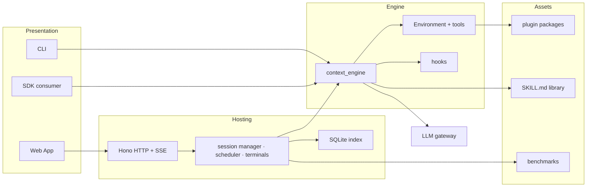
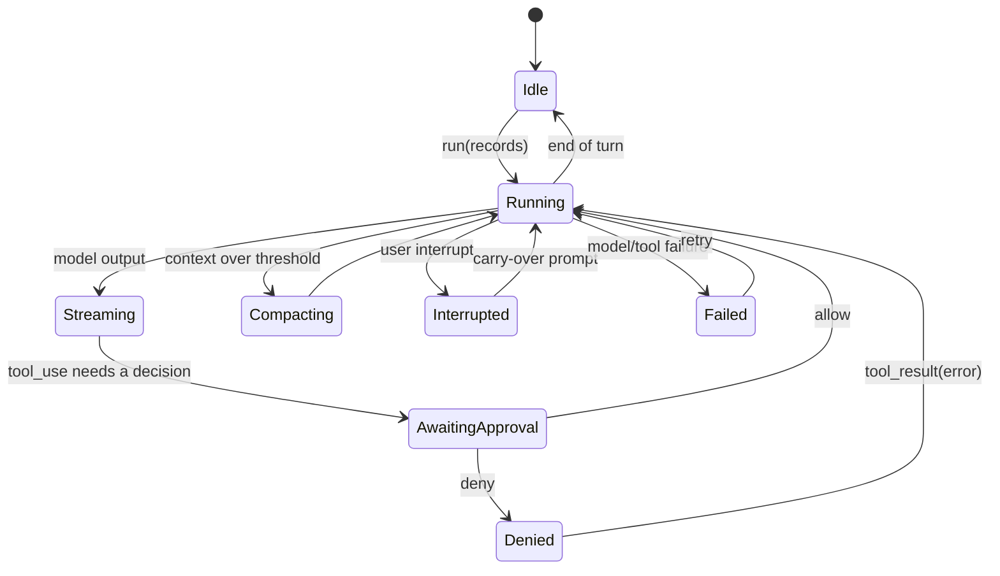

# Architecture

This document explains how NiceAgent is put together, why the boundaries sit where they do, and
where to extend it. It is written for someone who intends to change the code, not just run it.

## 1. Design intent

NiceAgent is built around a simple observation: every team that ships an agent product ends up
building the same machinery around the model call.

- a **loop** that can stream, act, be interrupted and resume;
- a **record protocol** that survives restarts and can be replayed;
- a **host** that runs many sessions for many users across many projects;
- **approvals** that are enforced in the runtime, not in the UI;
- **skills, hooks and plugins** that can be shipped and versioned;
- **traces, cost and evaluation**, because prompt changes are experiments.

NiceAgent ships that machinery as one framework, so a team can start from a working whole and
replace only the parts that make their product different.

Four principles shape every boundary below:

1. **Harness, not a graph library.** The loop is one piece of the product; hosting, storage, UI
   and evaluation are part of the same framework rather than homework left to the integrator.
2. **One truth, several views.** Web, CLI and SDK read the same append-only record stream. There is
   no second, UI-only notion of "what happened".
3. **Files first, indexes second.** Anything a user would care about (sessions, traces, workspaces,
   agent config) exists as files they can read and back up. SQLite is a queryable index over them.
4. **Everything is replaceable.** Models, tools, sandboxes, storage layout, product pages and the
   UI itself are extension points with documented contracts — see §5 and the *Customization*
   chapter of the README.

## 2. Layers



| Layer | Package | Owns | Must not own |
| --- | --- | --- | --- |
| Protocol | `@niceagent/amsp` | Record shapes, markers, serialisation | Transport, policy |
| Engine | `@niceagent/core` | The loop, interfaces, hooks, skills, plugin loader, trace writer | HTTP, users, UI |
| Host | `@niceagent/server` | Auth, authorization, session runtime, storage, SSE, terminals, benchmarks | Model-specific logic, rendering |
| Client | `@niceagent/web` | Rendering, navigation, optimistic UI | Persistence, policy |
| Client | `@niceagent/cli` | Terminal UX, scripting surface | Server-only state |
| Shared | `@niceagent/ui`, `@niceagent/skills`, `@niceagent/hmr` | Design system, frontmatter parsing, hot-update primitives | Product behaviour |

The dependency rule is one-way: **web/cli → server → core → amsp**. Core never imports the server,
and the server never imports the web app (the built SPA is a static asset, not a module).

## 3. The run lifecycle

A run is a sequence of AMSP records. The engine appends; every client reads.



Key invariants:

- **Approvals are runtime state.** A tool call parks in the engine; the UI's approval card is only a
  view of that parked call. Restarting the server denies anything that was pending — it never
  silently resumes.
- **Interrupts are explicit records.** The user's interrupt becomes part of the transcript, and the
  next run reads it as context rather than losing it.
- **Compaction is observable.** Compaction events are recorded, so a compressed session can still be
  audited.
- **Resume is replay.** A session restores by reading its trace; there is no second state store to
  drift from it.

## 4. State and storage

```
<data root>/
  web.db                       SQLite: users, auth sessions, authorization, indexes, usage
  <project>/
    .project_config.toml       model providers, models, credentials (0600), plugin list
    agents/<agent>/
      agent_state/             config, skills/, hooks/, workbenches/, schedule/
      sessions/<session>/
        trace.jsonl            append-only AMSP records
        workspace/             the files the agent works on
```

- `<data root>` defaults to `~/.niceagent/data` and is shared by SDK, CLI and server.
- Credentials never leave the server unmasked; the API returns masked values only.
- Deleting a project removes its directory; the SQLite index is rebuilt from disk on demand where
  possible, so a lost database degrades to "slower first start", not "lost work".

## 5. Extension points

| Point | Contract | Location |
| --- | --- | --- |
| **Skill** | `SKILL.md` with frontmatter (`name`, `description`, `version`) + optional reference files | `plugins/*/skills/` |
| **Hook** | `hooks/*.mjs` exporting prompt/tool/stop hooks; installed per agent | `plugins/*/hooks/` |
| **MCP server** | Declared in the plugin manifest; merged into the agent's `tools.mcpServers` | plugin `package.json` |
| **Tool** | Implemented in the environment layer, or supplied by an MCP server | `packages/core/src/environment` |
| **Sandbox backend** | Confinement interface; `bwrap`, `seatbelt`, `WSL` and `DSH` ship as references | `plugins/sandbox-*` |
| **Workbench page** | Self-contained HTML/JS page with a small host SDK | `plugins/*/workbenches/` |
| **Server module** | A module contributing HTTP routes, bound to the app at boot | `packages/server/src/http` |
| **Benchmark case** | `statement/`, `rubric/`, `benchmark_config.toml` | `benchmarks/` |

A plugin is an ordinary npm package. Its `niceagent` manifest block is the only special part:

```json
{
  "name": "@niceagent/example-plugin",
  "version": "0.2.18",
  "niceagent": {
    "title": "Example",
    "category": "office-productivity",
    "skills": ["example"],
    "hooks": { "version": "2026.11.02.1" },
    "mcp_servers": []
  }
}
```

Because plugins are npm packages with versions, "what an agent has installed" is a lockfile problem
rather than a bespoke database — and a plugin that fails to load fails loudly with its path instead
of silently shrinking the library.

## 6. Multi-user and multi-project hosting

- **Users** are global accounts; **projects** own agents, models and sessions.
- Authorization is checked in the server for every route; the UI hides what the API would refuse.
- Sessions belong to an agent inside a project; a terminal belongs to the *account* that created it
  and is deliberately not project-scoped.
- The first boot has no admin password: the server prints a one-time claim link. Setting
  `NICEAGENT_SEED_ADMIN_PASSWORD` pins it for automated deployments.

## 7. Deployment topologies

| Topology | How |
| --- | --- |
| Local development | `pnpm dev` — server on `:7368`, Vite on `:7365` with an API proxy |
| Single process | `pnpm build && node packages/server/dist/index.js` — the server hosts the built SPA |
| Container | `docker/compose.yaml` — one service, one volume at `/data`, loopback-published by default |
| Behind a proxy | Set `NICEAGENT_TRUST_PROXY=1`, forward `Host` and `x-forwarded-proto`, disable SSE buffering |

## 8. Deliberate trade-offs

- **Files over a database.** Large traces stay cheap to append and easy to copy; queries are slower,
  which is why the index exists.
- **One process by default.** Terminals, sessions and schedules run in-process. The seams for
  splitting them exist (the session manager and terminal module are isolated), but nothing pretends
  to be distributed today.
- **No silent degradation.** A missing plugin, a malformed manifest or an unsupported sandbox fails
  with a reason. The alternative — quietly running with less capability — produces wrong results that
  look right.
- **TypeScript everywhere.** One toolchain, one type system across the protocol, the loop and the
  UI. The cost is Node ≥ 24 for every deployment.

## 9. Versioning and compatibility

- Packages share one version, stamped at release.
- AMSP records are additive: new record kinds are ignored by older readers rather than rejected.
- Plugin manifests are read leniently only for operator-installed plugins, and every lenient read is
  surfaced as a warning.
- The database schema migrates forward on start; there is no downgrade path.
