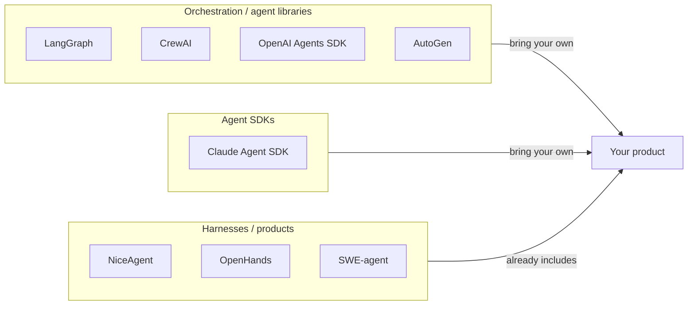

# NiceAgent compared with other agent frameworks and harnesses

This is a positioning document, not a scoreboard. Every project below is good at something, and
several are good at things NiceAgent deliberately does not attempt. The goal is to make the choice
explicit.

## 1. Two different products

The market is usually divided like this:

A **library** gives you a control-flow primitive and leaves the product around it to you: storage,
auth, approvals, UI, observability, evaluation. A **harness** is the product: the loop plus
everything that makes it operable.

NiceAgent is in the third column. That single decision explains most of the differences below.

## 2. Side-by-side

| Dimension | NiceAgent | LangGraph | AutoGen | CrewAI | OpenAI Agents SDK | Claude Agent SDK | OpenHands | SWE-agent |
| --- | --- | --- | --- | --- | --- | --- | --- | --- |
| Primary shape | Full self-hostable harness | Graph orchestration library | Conversational multi-agent library | Role-based crew library | Agent primitives | Agent loop SDK | Coding-agent platform | Coding-agent for benchmarks |
| Language | TypeScript | Python (JS port) | Python | Python | Python, JS/TS | Python, TS | Python | Python |
| Loop you inherit | Streaming loop with approvals, interrupts, compaction | Your graph | Group chat / handoffs | Sequential / hierarchical crews | Handoffs, guardrails | The Claude loop | Task agent | Single-issue agent |
| Multi-user auth + projects | **Built in** | No | No | No | No | No | Partial | No |
| Web UI shipped | **Yes** | No | Studio (dev tool) | No | No | No | Yes | Minimal |
| CLI over the same state | **Yes** | No | No | CLI for crews | No | Partial | Yes | Yes |
| Durable record store | **Yes** (append-only traces) | Checkpointer (you host it) | Optional | Partial | No | Session files | Yes | Yes |
| Resume / replay | **Yes** | Yes, via checkpoints | Partial | No | No | Partial | Yes | Yes |
| Human approval gate | **Runtime-enforced** | Add nodes yourself | Add logic yourself | Manual/human input | Needs wiring | Via permissions | Partial | No |
| Plugin/skill package format | **npm packages with versions** | No | Extensions | Tools | Tools | Skills/MCP | Tools | Tools |
| Sandbox backends | **bwrap, seatbelt, WSL, DSH** | No | No | No | No | No | Docker | Docker |
| Server-side terminals | **Yes** (pty owned by the server) | No | No | No | No | No | Yes | Yes |
| Built-in evaluation center | **Yes** (rubrics + scoreboards) | No | No | No | No | No | SWE-bench harness | SWE-bench harness |
| Provider-agnostic models | **Yes** (gateway, catalog, OAuth flows) | Yes | Yes | Yes | OpenAI-first | Anthropic | Yes | Yes |
| Org / company mode | **Yes** (departments, desks, channels) | No | No | No | No | No | No | No |

## 3. Project by project

### LangGraph

LangGraph's model is a graph of nodes over a shared state, with checkpointing as a first-class
concept. If your problem is "a state machine that calls models", it is a precise tool and its
checkpointing is more flexible than NiceAgent's session model.

Where NiceAgent differs: the checkpoint store is yours to host, and there is no opinion about users,
projects, approvals in the runtime, or a UI. NiceAgent ships one loop (a tool-using ReAct turn) and
focuses on the surrounding operations instead of arbitrary graph shapes.

### AutoGen

AutoGen explores multi-agent conversation: agents talking to agents, group chats, handoffs. It is a
research-flavoured toolkit and excellent for prototyping interaction patterns.

NiceAgent takes a different stance: one agent loop, with **subagents** as a tool, and an explicit
"company" mode for long-lived organisational structure (departments, desks, tickets, channels). The
agent-to-agent conversation is not the primitive; the durable session is.

### CrewAI

CrewAI's "role + task + crew" abstraction is a fast way to express a pipeline of cooperating agents.

NiceAgent does not have crews. It has agents that own sessions, and workbenches that give an agent a
small UI it can drive. The trade-off: less out-of-the-box role choreography, more emphasis on
long-running state, approvals and auditability.

### OpenAI Agents SDK

The Agents SDK (successor to Swarm) is a compact set of primitives — agents, handoffs, guardrails,
tracing hooks — and integrates naturally with OpenAI's platform.

NiceAgent is deliberately provider-agnostic: models are catalog entries with a client type, a base
URL and optional OAuth, routed through a gateway. The same credential can serve the Web App, the CLI
and an agent's own subagents.

### Claude Agent SDK

The Claude Agent SDK exposes the agent loop behind Claude Code: tools, permissions, subagents,
skills and MCP, with session files.

NiceAgent covers a similar loop but is not tied to one vendor, and adds the hosting layer: a
multi-user server, a Web App, a plugin registry, cost accounting, and a benchmark/evaluation center.
Conversely, the Claude Agent SDK is more tightly integrated with Anthropic's models and permissions
semantics than NiceAgent attempts to be.

### OpenHands and SWE-agent

Both are coding agents — strong at repository tasks and benchmark-driven evaluation, with container
sandboxing. NiceAgent is domain-agnostic: coding is one plugin's worth of skills, and the built-in
benchmark suite includes software, data-analysis, finance, science and support cases.

The overlap is real: for "fix this GitHub issue", a purpose-built coding agent is ahead. For "host a
general agent platform where coding is one of many capabilities", NiceAgent is the better fit.

## 4. What is actually different

These are the design decisions that are unusual in combination, rather than individually novel:

1. **The harness is the deliverable.** Server, Web App, CLI, storage and evaluation share one version
   and one release. There is no "reference implementation" to copy.
2. **A record protocol instead of a callback API.** `@niceagent/amsp` defines what happened. The
   UI, the CLI and the SDK are readers; replay and resume are consequences of that design.
3. **Approvals live in the runtime.** A pending tool call is engine state. Killing the process denies
   it. There is no path from "user clicked allow" to "different code ran".
4. **Files are the source of truth.** Sessions, traces and workspaces are files under one data root
   that the SDK, CLI and server all understand. SQLite is an index, not the archive.
5. **Plugins are npm packages.** Skills, hooks, MCP servers and workbench pages are packaged,
   versioned and installed per agent — so "what an agent can do" is inspectable and reproducible.
6. **The running platform can be updated without a rebuild.** The HMR layer lets a running server
   accept a new platform build behind `/api/hmr`, with hard stops for anything that cannot be swapped
   safely (parked approvals, running tasks).
7. **Evaluation is part of the product.** Rubrics, cases and scoreboards are first-class, so prompt
   and skill changes can be measured instead of argued about.
8. **Terminals are server-owned.** The pty and its screen live in the server; the browser is a thin
   client. A reload, a laptop sleep or a second device rebuilds the exact screen while the shell
   keeps running.

## 5. When to choose what

| If you want… | Reach for |
| --- | --- |
| A graph/state-machine abstraction you fully control | LangGraph |
| Research on multi-agent conversation patterns | AutoGen |
| A quick role-based pipeline in Python | CrewAI |
| Minimal primitives, OpenAI as the provider | OpenAI Agents SDK |
| Claude-first agent behaviour with permissions | Claude Agent SDK |
| An autonomous coding agent on a repository | OpenHands / SWE-agent |
| A self-hosted platform with UI, CLI, plugins, traces and evaluation | **NiceAgent** |

## 6. Honest limitations

- NiceAgent is early access; APIs may change between minor versions.
- There is no distributed runtime: sessions, terminals and schedules are in-process by design.
- The graph is a loop, not a DAG editor. Workflows with complex branching are expressed in code
  (skills, hooks, subagents) rather than in a visual graph.
- The built-in benchmark suite is small compared with SWE-bench-scale corpora.
- The plugin ecosystem starts at 29 packages; third-party plugins are the next milestone.

Corrections and counter-examples are welcome — open an issue with evidence and this document will be
updated.
