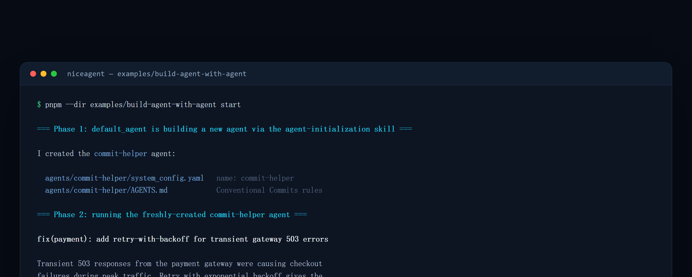

<!-- English | [简体中文](README.zh.md) -->

# Example: an Agent that builds another Agent (local, on an AMD GPU via Ollama)

This example is the **"Harness for Building Agents"** pillar in runnable code. Using only the
NiceAgent SDK, it:

1. **builds** a brand-new agent (`commit-helper`) by driving `default_agent` with the
   `agent-initialization` skill from a plain-language requirement, then
2. **runs** that freshly-created agent to prove the generated `AGENTS.md` actually shapes its
   behavior (it writes a Conventional Commits message).

Everything runs on a **local open-weight model** — `qwen3.6:35b` served by Ollama — so no cloud
API and no data leaving the machine. Ollama's ROCm backend runs this natively on AMD GPUs
(from Radeon PRO workstation cards up to Instinct accelerators).



> Illustrative output: wording and timing vary by model and machine; the two-phase structure does not.

## 0. Before you start

| Requirement | Version / notes | Check |
| --- | --- | --- |
| Node.js | ≥ 24 | `node -v` |
| pnpm | ≥ 11 | `pnpm -v` |
| Ollama | Can load `qwen3.6:35b`; AMD cards need a working ROCm backend | `ollama -v` |
| Repository | Cloned, and the shell is at its root | `ls examples/build-agent-with-agent` |

> No AMD card is required: Ollama falls back to other backends (NVIDIA / CPU), just slower. The model
> is large, so leave it enough VRAM or system memory.

## 1. Serve the model locally with Ollama

```bash
export HIP_VISIBLE_DEVICES=0   # optional: pin one AMD card
ollama serve &                 # if not already running as a service
ollama pull qwen3.6:35b        # first run downloads the model
ollama list                    # confirm the model is present
```

## 2. Point NiceAgent at it (once)

```bash
niceagent config model add \
  --model-id qwen3.6:35b \
  --provider custom --client-type openai \
  --base-url http://localhost:11434/v1 \
  --api-key ollama --set-default
```

This writes the model into `~/.niceagent/data/default_project/.project_config.toml`. The example
uses the project's default model, so no model id is hard-coded in the script. Confirm it with
`niceagent config model ls`.

## 3. Build and run the example

From the repo root (build the workspace first so `@niceagent/core` resolves to its `dist/`):

```bash
pnpm install
pnpm build
pnpm --dir examples/build-agent-with-agent start
# or directly:  npx tsx examples/build-agent-with-agent/build-agent.ts
```

The script prints one banner per phase:

```text
=== Phase 1: default_agent is building a new agent via the agent-initialization skill ===
=== Phase 2: running the freshly-created commit-helper agent ===
```

## 4. What you should see

**Phase 1 — the project gains an agent.** `default_agent` scaffolds `agents/commit-helper/`:

```text
agents/commit-helper/
  system_config.yaml   # copied from the base config, with name / description set
  AGENTS.md            # the Conventional Commits rules, written in plain language
```

**Phase 2 — the new agent is immediately usable.** Following only that generated `AGENTS.md`, it
produces something like:

```text
fix(payment): add retry-with-backoff for transient gateway 503 errors

Transient 503 responses from the payment gateway were causing checkout
failures during peak traffic. Retry with exponential backoff gives the
gateway time to recover, preventing spurious user-facing errors.
```

If the final output is empty, the script exits with status 1 and asks you to check Ollama and the
model configuration.

**Where the new agent lives.** Against the same data root it is already in the Web App's Agents
page, and the CLI can reach it:

```bash
pnpm niceagent agent ls
pnpm niceagent run -a commit-helper -m "Write a commit message for 'fix login timeout'"
```

## 5. What the script actually does

`build-agent.ts` is two SDK calls — there is no private scaffolding API:

```ts
const builder = await createAgent({ agentId: "default_agent" });
const buildSession = await builder.createSession({ workspaceDir: process.cwd() });
await buildSession.run([userText(BUILD_REQUEST)], { approve: async () => "allow" });

const helper = await createAgent({ agentId: "commit-helper" });
const helperSession = await helper.createSession({ workspaceDir: process.cwd() });
await helperSession.run([userText(COMMIT_TASK)], { approve: async () => "allow" });
```

- `approve` is the per-call approval callback. The example returns `"allow"` so it can run
  unattended; a real integration inspects each call — that is the point of the boundary.
- The build phase is driven entirely by the `agent-initialization` skill: the directory layout, the
  config copy and the shape of `AGENTS.md` live in the skill, not in the script.

## 6. Troubleshooting

| Symptom | Cause | Fix |
| --- | --- | --- |
| `connect ECONNREFUSED 127.0.0.1:11434` | Ollama is not running | `ollama serve`; verify with `curl http://localhost:11434/api/tags` |
| Empty output, exit status 1 | No usable default model, or a model that cannot call tools | Repeat step 2; switch to a model that follows the tool protocol reliably |
| `model "qwen3.6:35b" not found` | The pull did not finish | `ollama pull qwen3.6:35b`, then retry |
| Phase 1 is slow | First model load plus local inference | Later runs reuse the loaded model; a smaller model is fine for a smoke test |
| A generated config has a small format slip | The model re-serialized the base config mechanically | Every file is plain text and every run is traced; fix the line, then re-run phase 1 to update in place |

## Notes

- Output quality tracks the model. `qwen3.6:35b` handles this task well; much smaller models
  may not follow the tool-calling protocol reliably.
- A capable model occasionally introduces a mechanical slip when re-serializing the base config
  (e.g. an invalid YAML escape) — every file is plain text and every run is traced, so such
  slips are quick to spot and fix. This is the realistic shape of "agents building agents":
  the requirement→`AGENTS.md` heavy lifting is automated; a human reviews the mechanical edges.
- Re-running Phase 1 will update the existing `commit-helper` agent in place.
