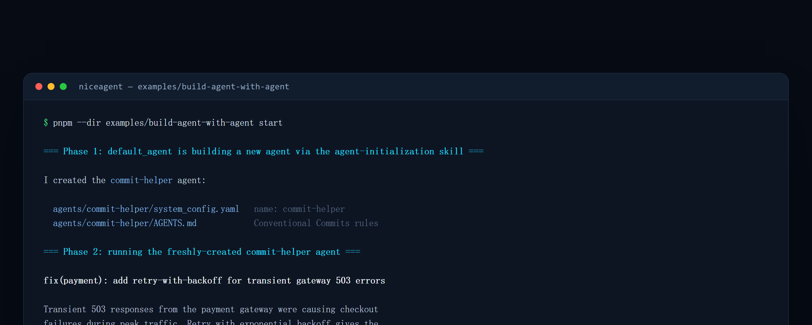

<!-- [English](README.md) | 简体中文 -->

# 示例：用一个 Agent 构建另一个 Agent（本地，经 Ollama 跑在 AMD GPU 上）

这个示例是 **“构建 Agent 的 Harness”** 支柱的可运行版本。仅用 NiceAgent SDK，它会：

1. **构建**一个全新的 Agent（`commit-helper`）——用 `agent-initialization` skill 驱动
   `default_agent`，根据一句大白话需求把它搭建出来；然后
2. **运行**这个刚创建的 Agent，证明生成的 `AGENTS.md` 确实塑造了它的行为（它会写出一条
   Conventional Commits 提交信息）。

全程跑在一个**本地开源权重模型**上——由 Ollama 提供的 `qwen3.6:35b`——所以不用任何云端 API、
数据也不离开本机。Ollama 的 ROCm 后端能原生在 AMD GPU 上运行它（从 Radeon PRO 工作站显卡一直到
Instinct 加速卡）。



> 截图为示意输出：模型与机器不同，措辞和速度会有差异，两个阶段的结构不变。

## 0. 运行前准备

| 依赖 | 版本 / 说明 | 检查方式 |
| --- | --- | --- |
| Node.js | ≥ 24 | `node -v` |
| pnpm | ≥ 11 | `pnpm -v` |
| Ollama | 能加载 `qwen3.6:35b`；AMD 显卡需可用的 ROCm 后端 | `ollama -v` |
| 仓库 | 已克隆并位于仓库根目录 | `ls examples/build-agent-with-agent` |

> 没有 AMD 显卡也可以跑：Ollama 会回退到其他后端（NVIDIA / CPU），只是更慢。模型较大，请预留足够的
> 显存或内存。

## 1. 用 Ollama 在本地提供模型

```bash
export HIP_VISIBLE_DEVICES=0   # 可选：指定某张 AMD 显卡；多卡时可省略
ollama serve &                 # 若尚未作为系统服务运行
ollama pull qwen3.6:35b        # 首次需要下载模型
ollama list                    # 确认模型已在本地
```

## 2. 把 NiceAgent 指向它（一次即可）

```bash
niceagent config model add \
  --model-id qwen3.6:35b \
  --provider custom --client-type openai \
  --base-url http://localhost:11434/v1 \
  --api-key ollama --set-default
```

这会把模型写进 `~/.niceagent/data/default_project/.project_config.toml`。示例使用项目的默认模型，
所以脚本里没有硬编码任何 model id。用 `niceagent config model ls` 可以核对是否已成为默认模型。

## 3. 构建并运行示例

从仓库根目录执行（先构建 workspace，好让 `@niceagent/core` 解析到它的 `dist/`）：

```bash
pnpm install
pnpm build
pnpm --dir examples/build-agent-with-agent start
# 或直接运行：  npx tsx examples/build-agent-with-agent/build-agent.ts
```

脚本会依次打印两个阶段的横幅：

```text
=== Phase 1: default_agent is building a new agent via the agent-initialization skill ===
=== Phase 2: running the freshly-created commit-helper agent ===
```

## 4. 预期结果

**阶段一——项目里多出一个智能体。** `default_agent` 在项目下搭建 `agents/commit-helper/`：

```text
agents/commit-helper/
  system_config.yaml   # 复制自基础配置，改写了 name / description
  AGENTS.md            # 用自然语言写下的 Conventional Commits 规则
```

**阶段二——新智能体立刻可用。** 它只依据那份刚生成的 `AGENTS.md`，产出类似这样的提交信息：

```text
fix(payment): add retry-with-backoff for transient gateway 503 errors

Transient 503 responses from the payment gateway were causing checkout
failures during peak traffic. Retry with exponential backoff gives the
gateway time to recover, preventing spurious user-facing errors.
```

如果最后一行输出为空，脚本会以退出码 1 结束，并提示检查 Ollama 与模型配置。

**去哪里看这个新智能体。** 数据根不变的前提下，它已经出现在 Web App 的「智能体」页面，也可以直接用
CLI 找到：

```bash
pnpm niceagent agent ls
pnpm niceagent run -a commit-helper -m "为「修复登录超时」这条改动写提交信息"
```

## 5. 脚本究竟做了什么

`build-agent.ts` 只有两步 SDK 调用，没有私有的脚手架 API：

```ts
const builder = await createAgent({ agentId: "default_agent" });
const buildSession = await builder.createSession({ workspaceDir: process.cwd() });
await buildSession.run([userText(BUILD_REQUEST)], { approve: async () => "allow" });

const helper = await createAgent({ agentId: "commit-helper" });
const helperSession = await helper.createSession({ workspaceDir: process.cwd() });
await helperSession.run([userText(COMMIT_TASK)], { approve: async () => "allow" });
```

- `approve` 是逐次工具调用的审批回调。示例里直接返回 `"allow"` 以便无人值守；真实集成中应按调用内容
  判断是否放行——这正是审批边界存在的意义。
- 构建阶段完全由 `agent-initialization` skill 驱动：目录布局、配置复制、`AGENTS.md` 的写法都写在
  skill 里，而不是脚本里。

## 6. 常见问题

| 现象 | 原因 | 处理 |
| --- | --- | --- |
| `connect ECONNREFUSED 127.0.0.1:11434` | Ollama 没在运行 | `ollama serve`，或用 `curl http://localhost:11434/api/tags` 验证 |
| 输出为空并以退出码 1 结束 | 默认模型没配好，或模型不支持工具调用 | 重新执行第 2 步；换一个能稳定遵循工具协议的模型 |
| `model "qwen3.6:35b" not found` | 模型未下载完成 | `ollama pull qwen3.6:35b` 后重试 |
| 阶段一很慢 | 模型首次加载 + 本地推理 | 首次加载后同一进程内会快很多；也可换更小的模型验证流程 |
| 生成的配置有格式小瑕疵 | 模型重新序列化 base config 时的机械失误 | 文件都是纯文本、每次运行都有轨迹；手工改一行即可，重跑阶段一会就地更新 |

## 说明

- 输出质量取决于模型。`qwen3.6:35b` 能很好地完成这个任务；更小的模型可能无法可靠地遵循工具调用协议。
- 有能力的模型偶尔会在重新序列化 base config 时引入一个机械性的小失误（例如非法的 YAML 转义）——
  因为每个文件都是纯文本、每次运行都被追踪，这类失误很容易被发现并修复。这正是“用 Agent 造 Agent”
  真实的样子：把需求变成 `AGENTS.md` 的重活被自动化了，而机械层面的毛刺由人类来审阅。
- 再次运行第一阶段会就地更新已存在的 `commit-helper` Agent。
