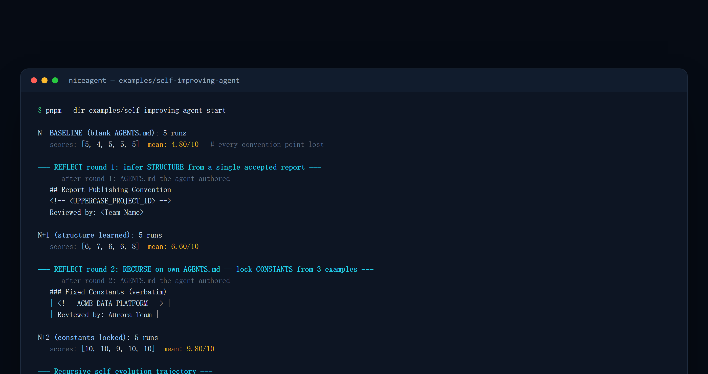

<!-- [English](README.md) | 简体中文 -->

# 示例：一个自我改进的 Agent（本地，经 Ollama 跑在 AMD GPU 上）

这个示例是 **“递归自我进化”** 支柱的可运行版本。仅用 NiceAgent SDK，Agent 就在**自己身上**跑完
自我进化循环——而关键在于：这次改进是由 *Agent 自己*产出的，不是脚本硬编码写死的：

1. **评估（Evaluate）** —— Agent 尝试一个约束型任务，并按 rubric（普通代码）打分。
2. **诊断（Diagnose）** —— *Agent 自己*把一次失败结果与一份通过范例并排对比。
3. **编辑（Edit）** —— *Agent 自己*归纳出缺失的规则，并写进它自己的 `AGENTS.md`。
4. **重新评估（Re-evaluate）** —— 重跑同一任务；只有平均分提升时才保留这次改动。

全程跑在一个**本地开源权重模型**上——由 Ollama 提供的 `qwen3.6:35b`——所以不用任何云端 API、数据也不
离开本机。Ollama 的 ROCm 后端能原生在 AMD GPU 上运行它。



> 截图为示意输出：分数与措辞每轮都会浮动，重点是两轮自我编写后的单调上升。

## 三个脚本（从机制到真正的自我进化）

| 脚本 | 演示什么 | 由谁编辑 `AGENTS.md` |
| --- | --- | --- |
| `self-improve.ts` | **评分闭环**的微缩版（最简） | **脚本**（硬编码） |
| `self-evolve.ts` | **真正的**单轮自我进化 | **Agent** 自己 |
| `self-evolve-recursive.ts` | **多轮递归**——主线（`pnpm start`） | **Agent**，连续两轮 |

`self-improve.ts` 是诚实的基线：它展示了 评估 → 编辑 → 重新评估 的机制，但那次编辑是人写好的
`DISCIPLINE` 字符串、由脚本写到磁盘。它演示的是*循环*，不是自我进化。两个 `self-evolve*` 脚本把
诊断**和**编辑都交给 Agent——脚本只提供一个失败信号和一份范例；学习由模型完成，并被固化进它自己的
身份文件。

## 任务，以及为什么 baseline 会稳定失败

任务看起来很简单：*把 `notes.txt` 总结进 `summary.md`，含一段 2 句概述和恰好 3 条要点——并遵守你们
团队的标准报告格式。* 玄机在最后一句：这个“团队格式”是一套**任意的内部约定**（一行 marker、一个
`# Report: <subject>` 标题、一行 `Classification: INTERNAL`、一行 `Reviewed-by: Aurora Team` 页脚），
它**只出现在 `AGENTS.md` 里**，**无法从任务本身推断**。

这正是让 baseline *稳定*烂的设计诀窍——对任何模型都成立，无论强弱。rubric（`score()`，普通代码）有
10 个原子分点：**5 个内容点**任何有能力的模型仅凭任务就能拿到，**5 个约定点**只能从 `AGENTS.md` 得知。
`AGENTS.md` 为空时，Agent 猜不到约定，于是稳定丢掉那 5 分。这是**信息缺口，不是能力缺口**——也正是
为什么更强的模型也没法“自己想出来”。它也对应了完整产品的形态：那里 Evaluator 由 `agent-evaluation`
skill 按一份*私有* rubric 驱动。

## 0. 运行前准备

| 依赖 | 版本 / 说明 | 检查方式 |
| --- | --- | --- |
| Node.js | ≥ 24 | `node -v` |
| pnpm | ≥ 11 | `pnpm -v` |
| Ollama | 能加载 `qwen3.6:35b`；AMD 显卡需可用的 ROCm 后端 | `ollama -v` |
| 仓库 | 已克隆并位于仓库根目录 | `ls examples/self-improving-agent` |

> 没有 AMD 显卡也可以跑：Ollama 会回退到其他后端（NVIDIA / CPU）。这个示例每轮要跑多次任务，比
> “构建 Agent”示例更吃推理时间，建议至少用与 `qwen3.6:35b` 同级的模型。

## 1–2. 提供模型并把 NiceAgent 指向它

```bash
export HIP_VISIBLE_DEVICES=0        # 可选：指定某张 AMD GPU
ollama serve &
ollama pull qwen3.6:35b

niceagent config model add \
  --model-id qwen3.6:35b \
  --provider custom --client-type openai \
  --base-url http://localhost:11434/v1 \
  --api-key ollama --set-default
```

配置写入 `~/.niceagent/data/default_project/.project_config.toml`；示例使用项目的默认模型，脚本里
没有硬编码 model id。

## 3. 运行示例

```bash
pnpm install
pnpm build
pnpm --dir examples/self-improving-agent start        # 递归主线（两轮）
# 或单轮：  npx tsx examples/self-improving-agent/self-evolve.ts
# 或评分闭环基线：  npx tsx examples/self-improving-agent/self-improve.ts
```

三个脚本共用同一套任务、rubric 与专用 agent id（`self-improve-demo`，运行时即时创建）。每次运行都会
先把该 demo agent 的 `AGENTS.md` 重置为空，因此可以反复跑、结果可对比。

## 4. 预期输出

一条完整的递归轨迹如下——先建立基线，再两轮自我编写：

```text
N  BASELINE (blank AGENTS.md): 5 runs
  ... scores: [5, 4, 5, 5, 5]  mean: 4.80/10      # 稳定丢掉每个约定点

=== REFLECT round 1: infer STRUCTURE from a single accepted report ===
----- after round 1: AGENTS.md the agent authored -----
  ## Report-Publishing Convention ...
  <!-- <UPPERCASE_PROJECT_ID> -->                  # 学到结构，但常量还是猜的
  Reviewed-by: <Team Name>

N+1 (structure learned): 5 runs
  ... scores: [6, 7, 6, 6, 8]  mean: 6.60/10

=== REFLECT round 2: RECURSE on own AGENTS.md — lock CONSTANTS from 3 examples ===
----- after round 2: AGENTS.md the agent authored -----
  ### Fixed Constants (verbatim)
  | 1 | <!-- ACME-DATA-PLATFORM --> |               # 常量被锁定为字面量
  | Last line | Reviewed-by: Aurora Team |

N+2 (constants locked): 5 runs
  ... scores: [10, 10, 9, 10, 10]  mean: 9.80/10

=== Recursive self-evolution trajectory ===
  N (baseline): 4.80/10
  N+1 (structure): 6.60/10   (+1.80)
  N+2 (constants): 9.80/10   (+3.20)
  Monotonic improvement across two self-authored rounds — recursive self-evolution. ✔
```

重点在这条轨迹：只有一份通过范例时，Agent 能推断出**结构**，却分不清哪些 token 是固定常量、哪些是
每份报告要替换的字段（单个样本本就有歧义），于是卡在中途。给它**多份**共享同一 marker 和页脚的通过
范例后，它推断出“凡是在所有样本里都完全相同的，就是固定常量”，读取自己**上一轮**写的 `AGENTS.md`
再精炼它——这才是真正意义上的递归：`state_{n+1} = agent.reflect(state_n, 新证据)`。具体数字每次运行
会有波动；重点是那条单调上升的方向。

## 5. 循环里每一步由谁做

| 步骤 | 脚本负责 | Agent 负责 |
| --- | --- | --- |
| 评估 | 提供任务、运行 `score()`、汇总 5 次均值 | 完成任务、产出 `summary.md` |
| 诊断 | 挑一条失败结果 + 一份通过范例放进上下文 | 对比两者，指出缺了哪条规则 |
| 编辑 | 保留/回滚与写盘 | 写出新的 `AGENTS.md` 内容 |
| 再评估 | 重跑同一任务、比较均值 | 按新规则重新作答 |

脚本**从不**自己写那套约定：它只给失败信号、范例和保留/回滚的判断；学习由模型完成，并被固化进它自己
的身份文件。

## 6. 常见问题

| 现象 | 原因 | 处理 |
| --- | --- | --- |
| 每轮都是 4.80 左右、没有提升 | `AGENTS.md` 没写进去（模型只叙述、没调用写文件工具） | 换更强的模型；查看轨迹里是否出现写文件调用 |
| N+1 比 N 更低，脚本回滚了 | 弱模型“推断出规则但执行不稳” | 这是预期行为，不是 bug；换 `qwen3.6:35b` 级别模型 |
| `connect ECONNREFUSED 127.0.0.1:11434` | Ollama 没在运行 | `ollama serve`，或 `curl http://localhost:11434/api/tags` 验证 |
| 运行时间很长 | 每轮 5 次任务 × 3 轮，本地推理 | 先跑 `self-evolve.ts` 单轮验证链路，再跑递归主线 |
| 想重来一次 | demo agent 的 `AGENTS.md` 残留 | 再次运行脚本即可（每次都会重置为空） |

## 诚实的边界

- **自我进化需要一个足够强的模型。** 自己写出一条正确规则、然后*遵守它*，比坐享一条硬编码规则更难。
  较弱的模型（例如 `qwen3:8b`）常常能推断出规则却执行不稳（占位符没填、或者只叙述而不真正写文件），
  于是它的 N+1 可能*倒退*，脚本随之回滚。那次回滚是循环在诚实工作，不是 bug。
- **证据充分性是真实的。** N+1 卡在中位，是因为单份范例确实无法确定固定常量；N+2 能冲高，只因更多
  范例让常量变得可推断。这份提升是信息驱动的学习，不是噪声。

## 说明

- 使用一个专用 agent id（`self-improve-demo`），运行时即时创建——你自己的 Agent 不会被动到。
- 脚本从不自己写那套约定；它只提供失败报告、通过范例，以及保留/回滚的信号。
- 再次运行会把这个 demo agent 的 `AGENTS.md` 重置为空，并重新开始循环。
